<div align="center">

# Logistico · لوجستيكو — open-source delivery management system and courier app

**Open-source logistics software.** Free, self-hosted delivery management: orders, warehouses, trucks, a courier app with proof of delivery and barcode scanners, cash on delivery (COD), returns, shipment tracking and an audit log. Arabic and English. A company in Iraq starts with the country's governorates; a company anywhere else adds the regions and warehouses it delivers to.

[](https://github.com/Haix02/logistico-software/releases/latest)
[](https://github.com/Haix02/logistico-software/actions/workflows/ci.yml)
[](LICENSE)
[](https://github.com/Haix02/logistico-software/stargazers)
[](https://github.com/Haix02/logistico-software/discussions)
[](CONTRIBUTING.md)


Version 3.1 · Arabic-first (RTL) · English · .NET 10 · Blazor WebAssembly · PostgreSQL · Flutter mobile app · Apache-2.0

**[Website](https://haix02.github.io/logistico-software/)** · [Quick start](#quick-start) · [What it does](#what-it-does) · [Mobile app](#mobile-app) · [Demand intelligence](#demand-intelligence-the-data-advantage) · [Docs](#documentation) · [FAQ](#faq) · [Contributing](CONTRIBUTING.md)

**If Logistico is useful to you or your company, please ⭐ star it**: it is how other delivery companies find it.

A delivery company runs the whole day in one console: book a parcel, scan it through hubs, put it on a truck, hand it to a courier, collect the cash, and see why deliveries fail. The interface is **light by default** (a quiet grey frame and white work panels). Dark mode is one click in the top bar. Arabic is the default language and the layout is right-to-left.

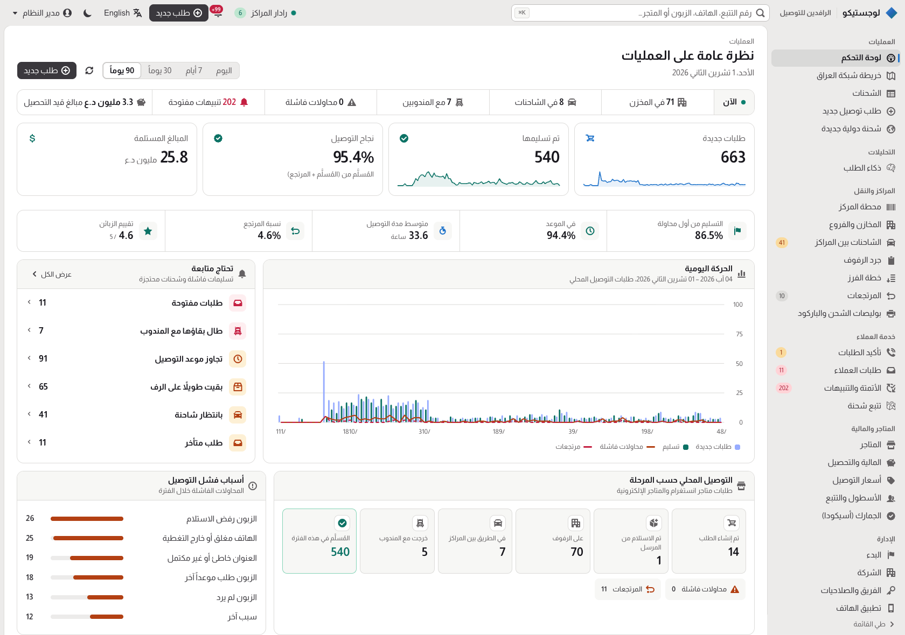

</div>

<div dir="rtl">

**لوجستيكو** برنامج لوجستي مفتوح المصدر ومجاني لشركات الشحن والتوصيل في أي بلد: الطلبات، الدفع عند الاستلام،
المخازن والرفوف، الشاحنات، تطبيق المندوب مع إثبات التسليم، المرتجعات، تسوية مستحقات المتاجر، وصفحة تتبع للزبون.
شركة في العراق تبدأ بمحافظاته؛ وشركة في بلد آخر تضيف مناطقها ومخازنها. الواجهة عربية من اليمين إلى اليسار، مع الإنجليزية.

</div>

## Why

Most delivery companies still run on spreadsheets, chat groups and closed systems that were not made for Arabic,
for cash on delivery, or for an address that is a neighbourhood and a landmark.

Logistico is open-source logistics software for that work: orders, warehouses and trucks, couriers, returns,
cash-on-delivery settlements and a public tracking page. A company in Iraq also gets the governorate network,
Instagram-shop orders and ASYCUDA customs. Because every order flows through it, it can answer **what customers order,
where, when, and why deliveries fail.** Companies can publish anonymised answers as open data.

## What it does

| Area | Highlights |
|---|---|
| **Delivery orders** (Instagram and online shops) | Seller, customer and Iraqi address (governorate, area, nearest landmark), pickup or drop-off, COD in IQD, automatic delivery promise (Fridays skipped), bulk booking, customer risk from past deliveries |
| **Order confirmation** | Hold risky orders until the customer confirms by call or on the tracking page; a call queue for customer support; auto-cancel unconfirmed ones |
| **Warehouses & branches** | Each company manages its own sorting hubs, branches and fulfilment stores per governorate: coverage, map position, shelf capacity, live load; routing and labels follow them |
| **Dashboard** | Period-over-period KPIs (booked, delivered, success, first attempt, on time, delivery time, returns, COD, customer rating), daily volume, pipeline, failure reasons, sellers, governorates, couriers |
| **Hubs and trucks** | Map of the 18 governorates, each hub's shelves and trucks, scan station, and line-haul manifests between hubs |
| **Hub station** | Barcode-scanner-first receive / load truck / dispatch / route check, shelves, scan log and live radar, printable command barcodes |
| **First run & getting started** | A setup page that creates the company and its first administrator with a one-time code from the server log; a guide that walks each role through setting the company up, done when the data says so; installation health that says what to fix before going live |
| **Sort plans** | Per hub: which parcels go on which shelves (couriers' areas, truck lanes, returns, a seller's own shelf) and how many fit; receive scans pick the shelf, overflow when one is full and show it large; shelves listed in walking order with their load |
| **Trucks between hubs** | Parcels planned onto the right truck automatically; load, depart and unload by scan; manifests; missing parcels flagged |
| **Returns** | Start automatically after the last failed attempt or a refusal, travel back by truck, handed over against a manifest |
| **Customers** | Public tracking without personal data; self-service requests (new day, address, phone, cancel, return, complaint) protected by the phone's last four digits with lockout; ratings that open complaints |
| **Automation** | Per-company rules (attempts, rescheduling, SLAs); alerts raised and cleared every minute; WhatsApp message queue |
| **Demand intelligence** | What customers buy, where, when, basket sizes vs refusals, trade lanes, repeat customers, plain-language findings, open-data export ([below](#demand-intelligence-the-data-advantage)) |
| **Money** | Delivery prices per company (own governorate, per destination, weight, seller discounts) quoted on the order form; cash held by couriers, seller COD balances, settlement batches (ZainCash, Qi Card, cash, bank) with CSV statements |
| **Courier app** | Couriers sign in on their phone and see only their parcels: address and landmark, cash to collect, call or WhatsApp the customer, mark delivered or not delivered with the reason; installable on the home screen |
| **Proof of delivery** | Who took the parcel (customer, family, neighbour… with a name), an optional finger signature, and the courier's location at every delivery and failed attempt, shown on the order |
| **Cash control** | Couriers hand in their cash against the parcels it covers, shortages recorded; sellers are paid only from cash the company holds; optional return fee for parcels sent back |
| **Shelf checks** | Count a hub shelf or a whole hub with a barcode scanner: missing, misplaced and unexpected parcels at once, misplaced ones fixed in one tap |
| **Audit log** | Who changed what and when — orders, prices, rules, payouts, sellers, staff accounts — with every field before and after; append-only |
| **Comments & saved views** | Staff notes on every order; each person's named list views and columns |
| **Seller portal** | Shops book their own orders (paste the customer's message), at the company's prices; follow orders and returns, cancel before pickup, see what they are owed and every payout with its statement |
| **Team & roles** | Administrators add colleagues and give them one of five office roles (Administrator, Operations, Customer support, Finance, Viewer), or Courier or Seller for the courier app and seller portal; lock, unlock and set new passwords; the API enforces every role and the screens follow it |
| **International freight & customs** | Bookings by sea/air/road, 4×6" AWB labels with Code-128, ASYCUDA workbench (SAD XML, CoO/invoice e-verification, duty estimate) |
| **Speed** | Command palette (`Ctrl/⌘+K`), keyboard shortcuts (`?`), barcode scanning from any page, phone layouts without sideways scrolling |

<table>
<tr>
<td width="50%">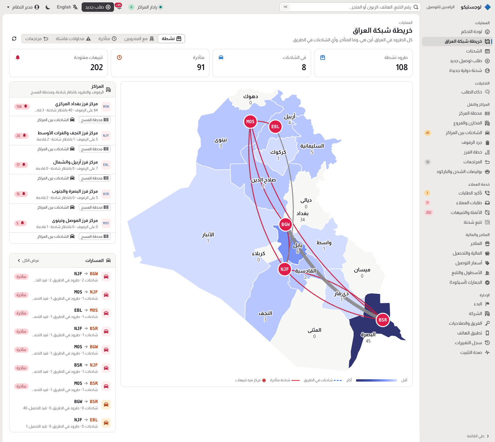</td>
<td width="50%">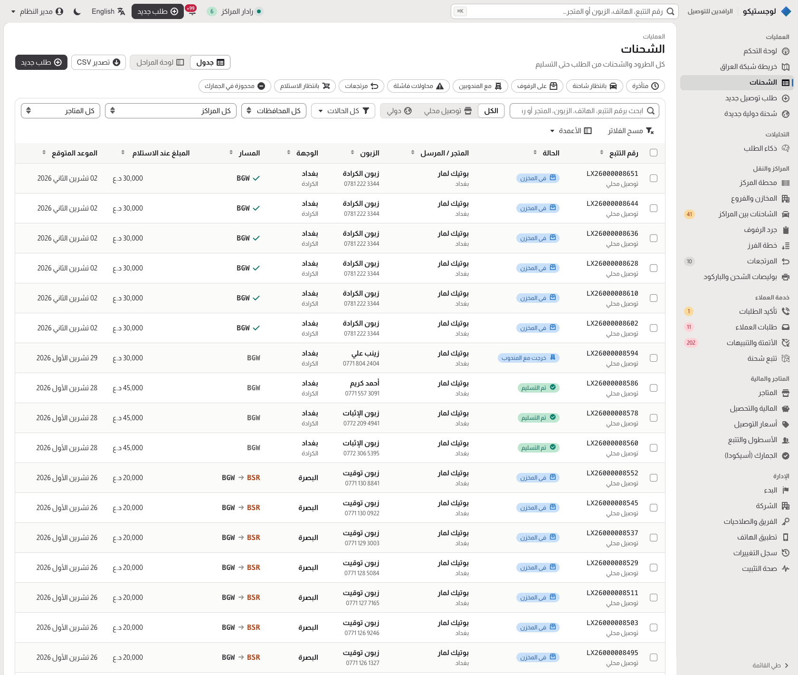</td>
</tr>
<tr>
<td align="center">Hubs and trucks on the Iraq map</td>
<td align="center">Shipments list</td>
</tr>
</table>

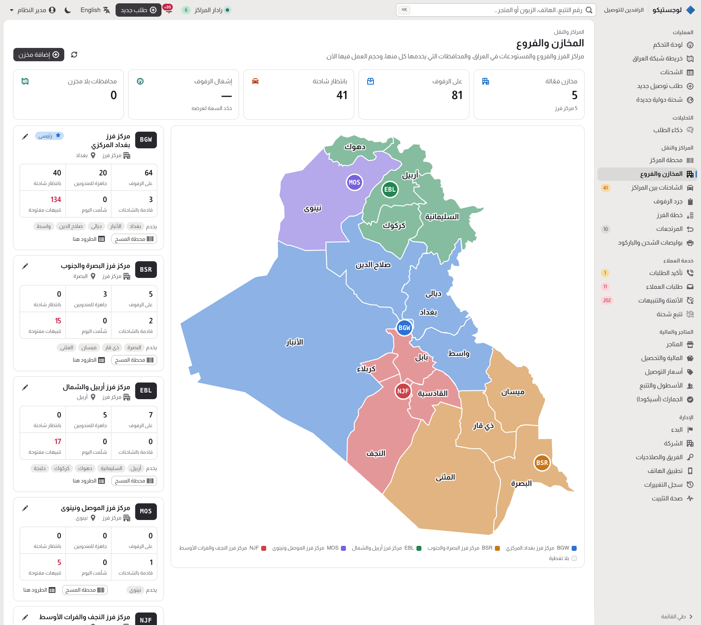

<table>
<tr>
<td width="50%">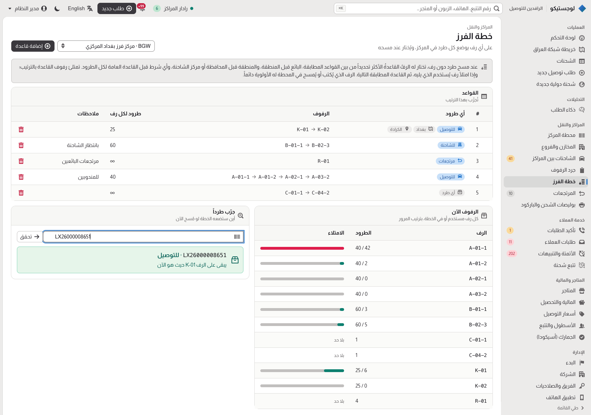</td>
<td width="50%">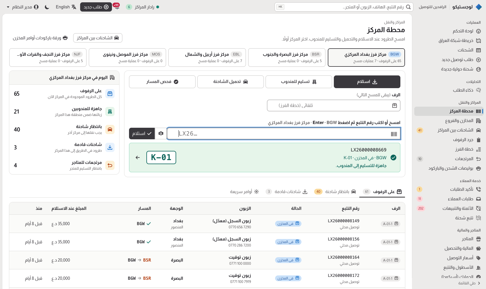</td>
</tr>
<tr>
<td align="center">Each hub's sort plan: rules, shelf loads, "where would this parcel go?"</td>
<td align="center">The station shows the shelf the plan chose</td>
</tr>
</table>

## Mobile app

One **Flutter** app for Android and iOS whose screens follow the account that signs in, and whose content the company
controls from the web console:

- **Senders (shops)** — book orders at the company's prices, follow them and their returns, see what they are owed.
- **Couriers** — the day's run, call or WhatsApp the customer, proof of delivery, cash to hand in; scanning with the
  **built-in scanner of Android handhelds**, a **Bluetooth/USB scanner gun**, or the camera.
- **Managers** — operations and delivery figures, alerts, hub scanning and shelf checks.

It signs in with the same accounts and roles as the web console. How to run and build it:
[mobile/README.md](mobile/README.md); the design: [09 — Client applications](docs/09-client-applications.md).

<p>
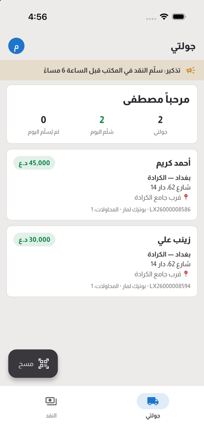
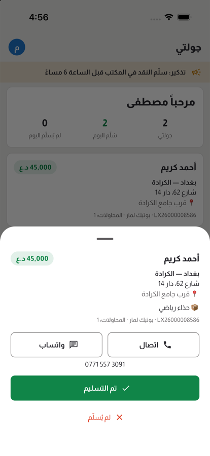
</p>

## Demand intelligence: the data advantage

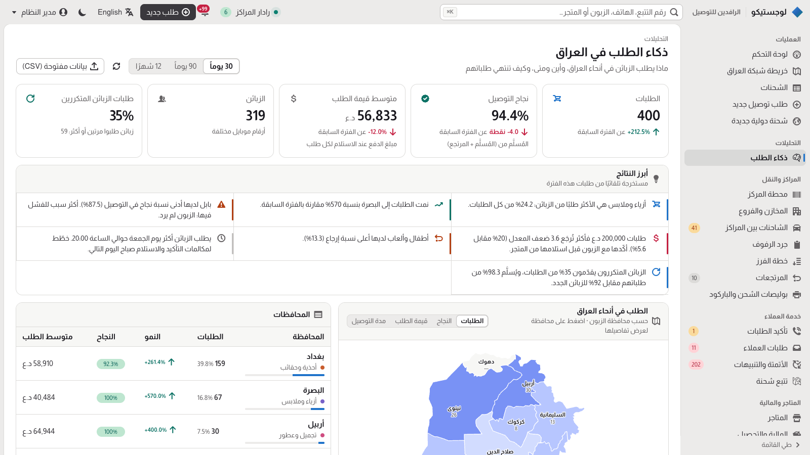

The **Intelligence → Demand intelligence** page turns a company's own deliveries into knowledge about the Iraqi market:

- **Demand across Iraq**: orders, delivery success, basket size and delivery time per governorate, with growth.
- **What customers buy**: item descriptions typed by sellers in Arabic or English (`فستان سهرة`, `AirPods case`) are
  recognised as product categories, with success and return rates per category.
- **When Iraq orders**: weekday × hour in Baghdad time, to plan confirmation calls, pickups and couriers.
- **Basket size vs refusals**: are expensive cash-on-delivery orders refused more? By how much?
- **Trade lanes** (seller's governorate → customer's governorate) and **repeat vs first-time customers**.
- **Key findings** written in plain Arabic or English, e.g. *"Orders of 200,000 IQD or more come back 7.9× as often as
  average. Confirm them with the customer before pickup."*
- **Open data (CSV)**: aggregates you can publish, with no names, phones or addresses, and groups under 10 orders left out.

How it works and how the data is protected: [docs/16-data-and-insights.md](docs/16-data-and-insights.md).

## Quick start

### With Docker (any OS)

```bash
# from a clone of this repository
docker compose up --build
```

Open **http://localhost:5210** and sign in with `admin@logistico.local` / `Logistico#2026`. The database is migrated and
filled with realistic demo data (12 Instagram shops, ~600 orders across Iraq, trucks, returns, requests). To see the
other roles, sign in as `ops@logistico.local` (Operations), `support@logistico.local` (Customer support),
`finance@logistico.local` (Finance) or `viewer@logistico.local` (Viewer) with the same password. This stack is for evaluation: it runs in the Development
environment over plain HTTP. For a real installation, read [Production readiness](docs/15-production-readiness.md).

### With the .NET SDK (development)

Prerequisites: [.NET 10 SDK](https://dotnet.microsoft.com/download) and PostgreSQL 16+.

```bash
psql -d postgres -c "CREATE ROLE logistico LOGIN PASSWORD 'logistico_dev' CREATEDB;"   # once
dotnet tool restore
dotnet run --project src/Logistico.Web --launch-profile http
```

- App: http://localhost:5210 · Public tracking: http://localhost:5210/track · OpenAPI: http://localhost:5210/openapi/v1.json
- Development signs in as `admin@logistico.local` / `Logistico#2026` with demo data (from `appsettings.Development.json`).
- The UI is in Arabic by default; switch to English from the top bar. Light theme by default; dark from the top bar.

### A new installation

Started without `Seed:AdminEmail`, Logistico has nobody to sign in yet. It writes a one-time **setup code** to its
log and every page leads to **`/setup`**: enter the code, your company's name and phone, and the first administrator
(with Docker: `docker compose logs app` shows the code). The page works once. You land on **Getting started**, a guide
that walks each role through what to set up (warehouses, prices, team, couriers, sellers, sort plan, the first order
and scan, automation, the mobile app) and is done when the data says so; **Installation health** lists what to fix
before real customers' data goes in. See [First run & getting started](docs/19-first-run-and-getting-started.md).

<table>
<tr>
<td width="50%">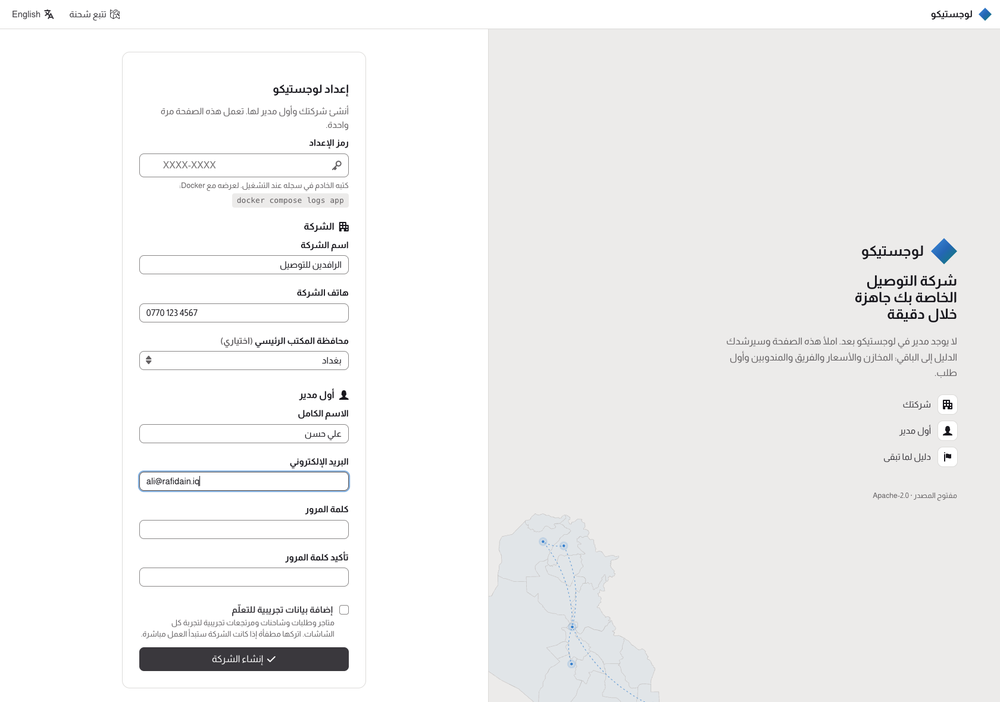</td>
<td width="50%">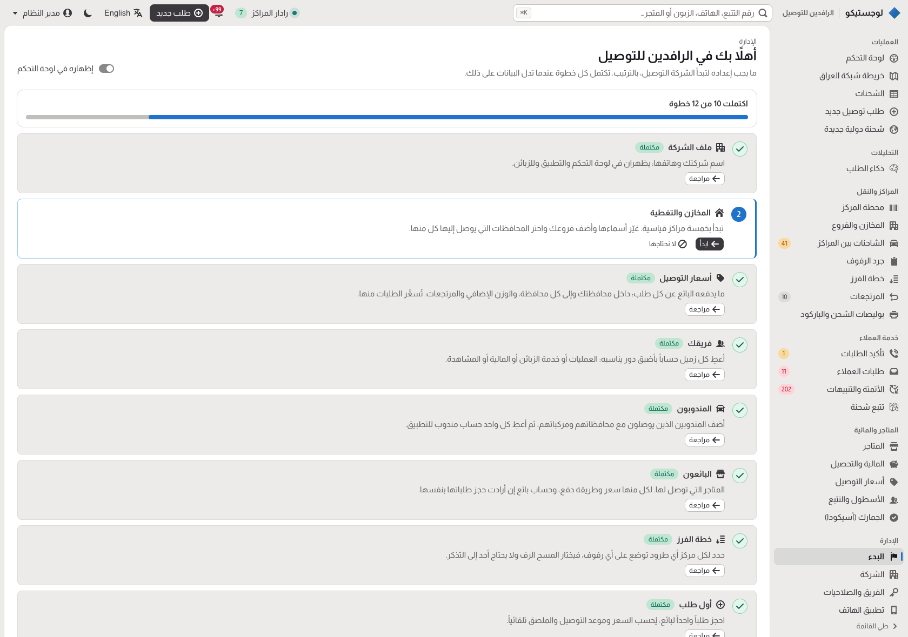</td>
</tr>
<tr>
<td align="center">The setup page (once, with the code from the log)</td>
<td align="center">Getting started, step by step</td>
</tr>
</table>

### Tests

```bash
dotnet test tests/Logistico.Modules.Shipments.Tests     # domain rules, product catalogue, open data, formatting, sort plans (260)
dotnet test tests/Logistico.ArchitectureTests            # module boundaries, texts in both languages, RTL/CSS and icon guards (33)
dotnet test tests/Logistico.Web.IntegrationTests         # REST API on real PostgreSQL: flows, roles, setup, every endpoint × every role (150)
dotnet test tests/Logistico.Web.Client.Tests             # the console: components (bUnit), navigation, plurals, texts (46)
```

Set `LOGISTICO_TEST_DB` to point the integration tests at another PostgreSQL server.

CI also measures line coverage of the server code and fails below 85 % (87.7 % today); see
[CONTRIBUTING](CONTRIBUTING.md) to measure it locally.

## Stack

| Layer | Choice |
|---|---|
| Language / runtime | C# on .NET 10 (LTS) |
| Web UI | Blazor WebAssembly with Logistico's own components. **GitLab Pajamas** sets the look (light by default, dark on request); **Blueprint 6** CSS and icons (Palantir, Apache-2.0) supply tables, menus, dialogs and hotkeys |
| Languages | Arabic (`ar-IQ`, default, RTL) and English; Almarai font; Western digits; Iraqi month names; Arabic plural forms |
| Backend | ASP.NET Core modular monolith (strict module boundaries, contracts shared with the browser) |
| Database | PostgreSQL with EF Core 10 (schema per module, snake_case, optimistic concurrency) |
| Identity | ASP.NET Core Identity (cookies, roles, 2FA, passkeys), multi-company (tenant) data isolation |
| Mobile | Flutter (Android and iOS), one app for senders, couriers and managers; Riverpod, go_router, dio |
| CI | GitHub Actions: format → build → tests on PostgreSQL → Docker image check → container image + migration bundles |

No paid licences, no map service, no CDN at run time: everything (Blueprint, fonts, the Iraq map) is vendored.

## Repository layout

```
src/
  Logistico.Web/              ASP.NET Core host: REST API, sign-in pages, serves the WebAssembly UI
  Logistico.Web.Client/       Blazor WebAssembly UI: components (Ui/), pages, typed API clients, ar/en texts
  Logistico.SharedKernel/     Tenancy, paging, Iraqi governorates and phone numbers, cultures
  Modules/Shipments/          Orders, hubs and trucks, returns, requests, automation, insights, customs, fleet, COD
  Modules/Merchants/          Sellers (Instagram / online shops)
  Modules/Audit/              Audit log: who changed what, recorded with every change
mobile/                       Flutter app for senders, couriers and managers (Android, iOS)
tests/                        Domain, architecture and API integration tests
docs/                         Architecture, decisions and guides (start with 00)
Dockerfile, docker-compose.yml
```

## Documentation

| # | Document | |
|---|---|---|
| 00 | [Overview](docs/00-overview.md) | What Logistico is, what is built, key decisions |
| 01 | [Research findings](docs/01-research-findings.md) | ASYCUDA in Iraq, open-source landscape, licensing |
| 02 | [Domain model](docs/02-domain-model.md) | Bounded contexts, shipment lifecycle, business rules |
| 03 | [System architecture](docs/03-system-architecture.md) | Components, module structure, performance |
| 04 | [Database design](docs/04-database-design.md) | PostgreSQL design, partitioning, HA/DR |
| 05 | [Infrastructure & deployment](docs/05-infrastructure-and-deployment.md) | Hosting in/near Iraq, containers |
| 06 | [Device integration](docs/06-device-integration.md) | GPS, scanners, label and receipt printers, scales |
| 07 | [Customs & ASYCUDA](docs/07-customs-asycuda.md) | ASYCUDA World, document e-verification |
| 08 | [UI/UX design system](docs/08-ui-ux-design-system.md) | Blueprint, the console theme, Arabic/RTL, keyboard, map |
| 09 | [Client applications](docs/09-client-applications.md) | Web now; desktop and mobile options |
| 10 | [Security & compliance](docs/10-security-and-compliance.md) | Identity, authorization, data protection, audit |
| 11 | [CI/CD & DevOps](docs/11-ci-cd-and-devops.md) | Pipeline, testing, releases, migrations |
| 12 | [Observability](docs/12-observability-and-operations.md) | Telemetry, SLOs, alerting |
| 13 | [Roadmap](docs/13-roadmap.md) | What is done, what is next, known limitations |
| 14 | [Architecture decisions](docs/14-architecture-decisions.md) | ADR log |
| 15 | [Production readiness](docs/15-production-readiness.md) | Configuration, go-live checklist, performance acceptance |
| 16 | [Data & demand intelligence](docs/16-data-and-insights.md) | Insights, product recognition, open data and privacy |
| 17 | [Release audits](docs/17-release-audits.md) | What each release checked and fixed |
| 18 | [Ideas from open source](docs/18-ideas-from-open-source.md) | What we took from Fleetbase, OpenBoxes, Karrio, Odoo, VROOM, Traccar |
| 19 | [First run & getting started](docs/19-first-run-and-getting-started.md) | The setup page, the getting-started guide, installation health |

## Alternatives and how Logistico differs

Logistico is an open-source alternative to closed delivery platforms (Onfleet, Shipday, Tookan) and to general systems
adapted for delivery (Odoo, ERPNext). Compared with open-source projects such as [Fleetbase](https://github.com/fleetbase/fleetbase)
or [OpenBoxes](https://openboxes.com), it is built around **cash on delivery**, **Arabic and right-to-left first**,
**Iraqi addresses** (governorate, area, nearest landmark), **line-haul between governorate hubs**, and **ASYCUDA customs**.

## FAQ

<details>
<summary><b>Is there a free, open-source delivery management system?</b></summary>

Yes: Logistico is free under Apache-2.0. Run it on your own server, change it, and use it commercially. It covers
orders, hubs, trucks, couriers, cash on delivery, returns, tracking and customs in one system.
</details>

<details>
<summary><b>Does it work in Arabic? / هل يعمل بالعربية؟</b></summary>

Arabic is the default language, right to left, with English one click away; addresses follow how Iraqis give them
(governorate, area, nearest landmark). نعم، العربية هي اللغة الافتراضية والواجهة من اليمين إلى اليسار.
</details>

<details>
<summary><b>Is there a courier app with barcode scanning?</b></summary>

One Flutter app for Android and iOS serves couriers, sellers and managers. Couriers deliver with proof of delivery
(receiver, signature, location) and scan with the built-in scanners of Android handhelds, Bluetooth/USB scanner guns or
the camera.
</details>

<details>
<summary><b>How do I install it for a real company?</b></summary>

Start it without demo settings: it writes a one-time setup code to its log, `/setup` creates your company and its
first administrator, and a getting-started guide takes you through the rest. See
[Production readiness](docs/15-production-readiness.md) and [First run](docs/19-first-run-and-getting-started.md).
</details>

<details>
<summary><b>How is it different from Fleetbase, Odoo or Onfleet?</b></summary>

See [Alternatives](#alternatives-and-how-logistico-differs): cash on delivery, Arabic and right-to-left first, Iraqi
addresses, line-haul between governorate hubs, sort plans and ASYCUDA customs are built in, not added on.
</details>

## Contributing

Bug reports from real hubs, Arabic and Kurdish product words, new integrations (couriers, payment wallets, WhatsApp),
and code are all welcome. Start with a [good first issue](https://github.com/Haix02/logistico-software/labels/good%20first%20issue),
ask anything in [Discussions](https://github.com/Haix02/logistico-software/discussions), and read
[CONTRIBUTING.md](CONTRIBUTING.md) for setup and house rules, and [CODE_OF_CONDUCT.md](CODE_OF_CONDUCT.md). Report
security issues privately: [SECURITY.md](SECURITY.md). Questions about using it: [SUPPORT.md](SUPPORT.md).

## Star history

[](https://star-history.com/#Haix02/logistico-software&Date)

## Licence

[Apache License 2.0](LICENSE). Third-party assets and their licences are listed in [NOTICE](NOTICE).
