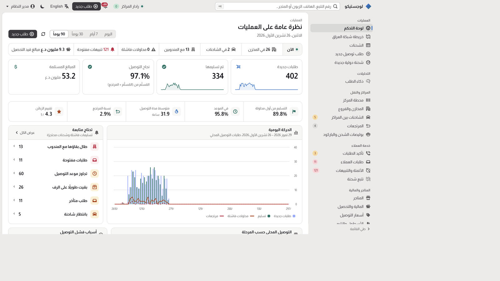
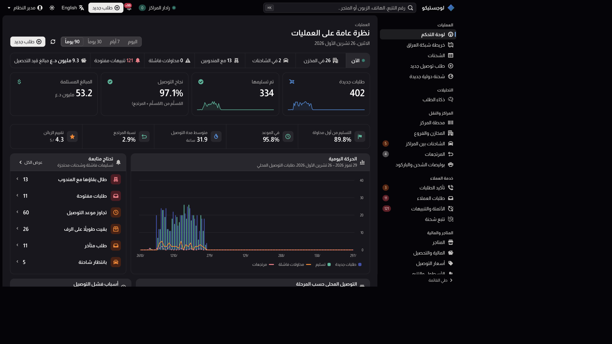
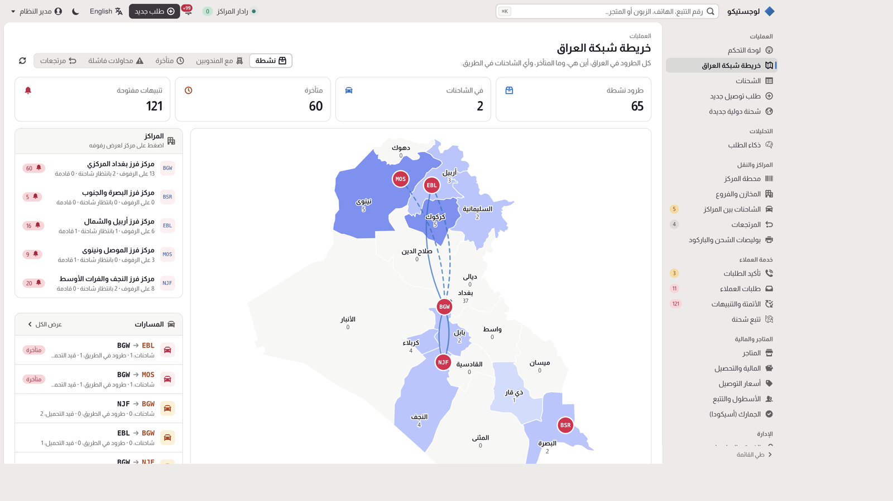
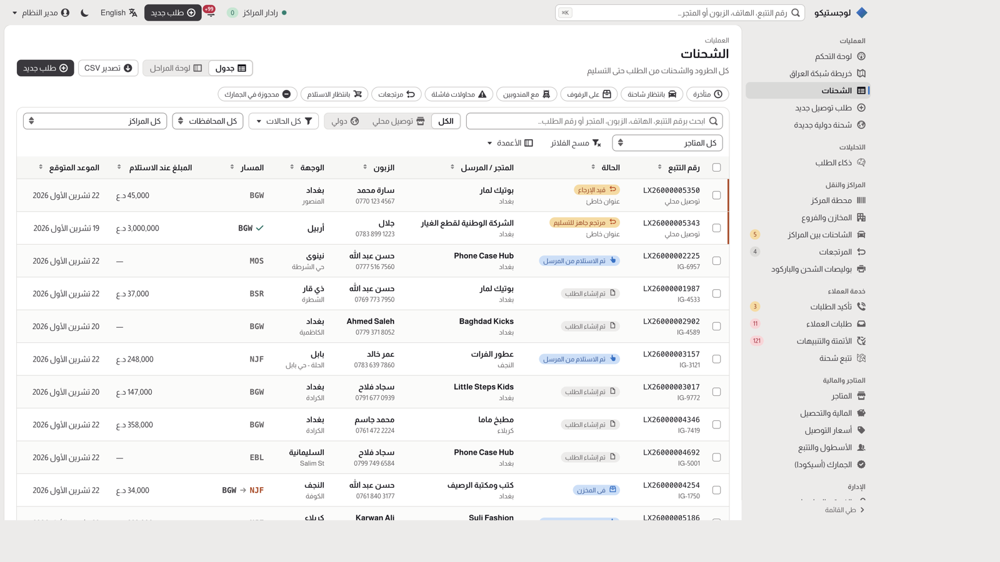
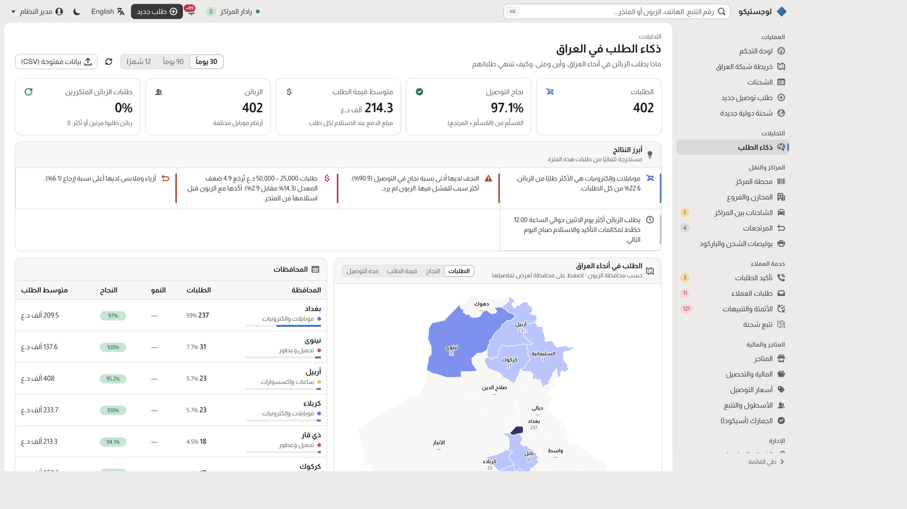

<div align="center">

# Logistico · لوجستيكو

**Open-source logistics and delivery management system: orders, warehouses, trucks, couriers, shipment tracking, returns and cash on delivery — built for Iraq, useful anywhere the address is a neighbourhood and a landmark.**

Version 3.0 · Arabic-first (RTL) · English · .NET 10 · Blazor WebAssembly · PostgreSQL · Apache-2.0

[Quick start](#quick-start) · [What it does](#what-it-does) · [Demand intelligence](#demand-intelligence-the-data-advantage) · [Docs](#documentation) · [Contributing](CONTRIBUTING.md)

A delivery company runs the whole day in one console: book a parcel, scan it through hubs, put it on a truck, hand it to a courier, collect the cash, and see why deliveries fail. The interface is **light by default** (a quiet grey frame and white work panels). Dark mode is one click in the top bar. Arabic is the default language and the layout is right-to-left.





</div>

## Why

Iraqi e-commerce runs on Instagram shops, cash on delivery and couriers who know every neighbourhood by its nearest
landmark. The software behind it is mostly spreadsheets, WhatsApp groups and closed systems that were not made for
Arabic, for Iraqi addresses, or for cash.

Logistico is a complete, free system for a delivery company: orders, hubs and trucks between governorates, couriers,
returns, cash-on-delivery settlements, customs, and a public tracking page. Because every order flows through it, it
also answers questions nobody in the market could answer before: **what do Iraqi customers order, where, when, and why
do deliveries fail?** Companies can publish anonymised answers as open data, so the whole industry can learn.

## What it does

| Area | Highlights |
|---|---|
| **Delivery orders** (Instagram and online shops) | Seller, customer and Iraqi address (governorate, area, nearest landmark), pickup or drop-off, COD in IQD, automatic delivery promise (Fridays skipped), bulk booking, customer risk from past deliveries |
| **Order confirmation** | Hold risky orders until the customer confirms by call or on the tracking page; a call queue for customer support; auto-cancel unconfirmed ones |
| **Warehouses & branches** | Each company manages its own sorting hubs, branches and fulfilment stores per governorate: coverage, map position, shelf capacity, live load; routing and labels follow them |
| **Dashboard** | Period-over-period KPIs (booked, delivered, success, first attempt, on time, delivery time, returns, COD, customer rating), daily volume, pipeline, failure reasons, sellers, governorates, couriers |
| **Iraq network** | Built-in map of the 18 governorates, hubs with live load, trucks on the road, misroute alerts |
| **Hub station** | Barcode-scanner-first receive / load truck / dispatch / route check, shelves, scan log and live radar, printable command barcodes |
| **Trucks between hubs** | Parcels planned onto the right truck automatically; load, depart and unload by scan; manifests; missing parcels flagged |
| **Returns** | Start automatically after the last failed attempt or a refusal, travel back by truck, handed over against a manifest |
| **Customers** | Public tracking without personal data; self-service requests (new day, address, phone, cancel, return, complaint) protected by the phone's last four digits with lockout; ratings that open complaints |
| **Automation** | Per-company rules (attempts, rescheduling, SLAs); alerts raised and cleared every minute; WhatsApp message queue |
| **Demand intelligence** | What customers buy, where, when, basket sizes vs refusals, trade lanes, repeat customers, plain-language findings, open-data export ([below](#demand-intelligence-the-data-advantage)) |
| **Money** | Delivery prices per company (own governorate, per destination, weight, seller discounts) quoted on the order form; cash held by couriers, seller COD balances, settlement batches (ZainCash, Qi Card, cash, bank) with CSV statements |
| **Courier app** | Couriers sign in on their phone and see only their parcels: address and landmark, cash to collect, call or WhatsApp the customer, mark delivered or not delivered with the reason; installable on the home screen |
| **Seller portal** | Shops book their own orders (paste the customer's message), at the company's prices; follow orders and returns, cancel before pickup, see what they are owed and every payout with its statement |
| **Team & roles** | Administrators add colleagues and give them one of five office roles (Administrator, Operations, Customer support, Finance, Viewer), or Courier or Seller for the courier app and seller portal; lock, unlock and set new passwords; the API enforces every role and the screens follow it |
| **International freight & customs** | Bookings by sea/air/road, 4×6" AWB labels with Code-128, ASYCUDA workbench (SAD XML, CoO/invoice e-verification, duty estimate) |
| **Speed** | Command palette (`Ctrl/⌘+K`), keyboard shortcuts (`?`), barcode scanning from any page, phone layouts without sideways scrolling |

<table>
<tr>
<td width="50%"></td>
<td width="50%"></td>
</tr>
<tr>
<td align="center">Iraq network map (Arabic, right-to-left)</td>
<td align="center">Shipments list (light theme)</td>
</tr>
</table>

## Demand intelligence: the data advantage



The **Intelligence → Demand intelligence** page turns a company's own deliveries into knowledge about the Iraqi market:

- **Demand across Iraq**: orders, delivery success, basket size and delivery time per governorate, with growth.
- **What customers buy**: item descriptions typed by sellers in Arabic or English (`فستان سهرة`, `AirPods case`) are
  recognised as product categories, with success and return rates per category.
- **When Iraq orders**: weekday × hour in Baghdad time, to plan confirmation calls, pickups and couriers.
- **Basket size vs refusals**: are expensive cash-on-delivery orders refused more? By how much?
- **Trade lanes** (seller's governorate → customer's governorate) and **repeat vs first-time customers**.
- **Key findings** written in plain Arabic or English, e.g. *"Orders of 200,000 IQD or more come back 7.9× as often as
  average. Confirm them with the customer before pickup."*
- **Open data (CSV)**: aggregates you can publish, with no names, phones or addresses, and groups under 10 orders left out.

How it works and how the data is protected: [docs/16-data-and-insights.md](docs/16-data-and-insights.md).

## Quick start

### With Docker (any OS)

```bash
# from a clone of this repository
docker compose up --build
```

Open **http://localhost:5210** and sign in with `admin@logistico.local` / `Logistico#2026`. The database is migrated and
filled with realistic demo data (12 Instagram shops, ~600 orders across Iraq, trucks, returns, requests). To see the
other roles, sign in as `ops@logistico.local` (Operations), `support@logistico.local` (Customer support),
`finance@logistico.local` (Finance) or `viewer@logistico.local` (Viewer) with the same password. This stack is for evaluation: it runs in the Development
environment over plain HTTP. For a real installation, read [Production readiness](docs/15-production-readiness.md).

### With the .NET SDK (development)

Prerequisites: [.NET 10 SDK](https://dotnet.microsoft.com/download) and PostgreSQL 16+.

```bash
psql -d postgres -c "CREATE ROLE logistico LOGIN PASSWORD 'logistico_dev' CREATEDB;"   # once
dotnet tool restore
dotnet run --project src/Logistico.Web --launch-profile http
```

- App: http://localhost:5210 · Public tracking: http://localhost:5210/track · OpenAPI: http://localhost:5210/openapi/v1.json
- The UI is in Arabic by default; switch to English from the top bar. Light theme by default; dark from the top bar.

### Tests

```bash
dotnet test tests/Logistico.Modules.Shipments.Tests     # domain rules, product catalogue, open data, formatting (207)
dotnet test tests/Logistico.ArchitectureTests            # module boundaries, texts in both languages, RTL/CSS and icon guards (31)
dotnet test tests/Logistico.Web.IntegrationTests         # REST API on real PostgreSQL: flows, roles, team safety, tenants (62)
```

Set `LOGISTICO_TEST_DB` to point the integration tests at another PostgreSQL server.

## Stack

| Layer | Choice |
|---|---|
| Language / runtime | C# on .NET 10 (LTS) |
| Web UI | Blazor WebAssembly with Logistico's own components. **GitLab Pajamas** sets the look (light by default, dark on request); **Blueprint 6** CSS and icons (Palantir, Apache-2.0) supply tables, menus, dialogs and hotkeys |
| Languages | Arabic (`ar-IQ`, default, RTL) and English; Almarai font; Western digits; Iraqi month names; Arabic plural forms |
| Backend | ASP.NET Core modular monolith (strict module boundaries, contracts shared with the browser) |
| Database | PostgreSQL with EF Core 10 (schema per module, snake_case, optimistic concurrency) |
| Identity | ASP.NET Core Identity (cookies, roles, 2FA, passkeys), multi-company (tenant) data isolation |
| CI | GitHub Actions: format → build → tests on PostgreSQL → Docker image check → container image + migration bundles |

No paid licences, no map service, no CDN at run time: everything (Blueprint, fonts, the Iraq map) is vendored.

## Repository layout

```
src/
  Logistico.Web/              ASP.NET Core host: REST API, sign-in pages, serves the WebAssembly UI
  Logistico.Web.Client/       Blazor WebAssembly UI: components (Ui/), pages, typed API clients, ar/en texts
  Logistico.SharedKernel/     Tenancy, paging, Iraqi governorates and phone numbers, cultures
  Modules/Shipments/          Orders, hubs and trucks, returns, requests, automation, insights, customs, fleet, COD
  Modules/Merchants/          Sellers (Instagram / online shops)
tests/                        Domain, architecture and API integration tests
docs/                         Architecture, decisions and guides (start with 00)
Dockerfile, docker-compose.yml
```

## Documentation

| # | Document | |
|---|---|---|
| 00 | [Overview](docs/00-overview.md) | What Logistico is, what is built, key decisions |
| 01 | [Research findings](docs/01-research-findings.md) | ASYCUDA in Iraq, open-source landscape, licensing |
| 02 | [Domain model](docs/02-domain-model.md) | Bounded contexts, shipment lifecycle, business rules |
| 03 | [System architecture](docs/03-system-architecture.md) | Components, module structure, performance |
| 04 | [Database design](docs/04-database-design.md) | PostgreSQL design, partitioning, HA/DR |
| 05 | [Infrastructure & deployment](docs/05-infrastructure-and-deployment.md) | Hosting in/near Iraq, containers |
| 06 | [Device integration](docs/06-device-integration.md) | GPS, scanners, label and receipt printers, scales |
| 07 | [Customs & ASYCUDA](docs/07-customs-asycuda.md) | ASYCUDA World, document e-verification |
| 08 | [UI/UX design system](docs/08-ui-ux-design-system.md) | Blueprint, the console theme, Arabic/RTL, keyboard, map |
| 09 | [Client applications](docs/09-client-applications.md) | Web now; desktop and mobile options |
| 10 | [Security & compliance](docs/10-security-and-compliance.md) | Identity, authorization, data protection, audit |
| 11 | [CI/CD & DevOps](docs/11-ci-cd-and-devops.md) | Pipeline, testing, releases, migrations |
| 12 | [Observability](docs/12-observability-and-operations.md) | Telemetry, SLOs, alerting |
| 13 | [Roadmap](docs/13-roadmap.md) | What is done, what is next, known limitations |
| 14 | [Architecture decisions](docs/14-architecture-decisions.md) | ADR log |
| 15 | [Production readiness](docs/15-production-readiness.md) | Configuration, go-live checklist, performance acceptance |
| 16 | [Data & demand intelligence](docs/16-data-and-insights.md) | Insights, product recognition, open data and privacy |
| 17 | [Release audits](docs/17-release-audits.md) | What each release checked and fixed |

## Contributing

Bug reports from real hubs, Arabic and Kurdish product words, new integrations (couriers, payment wallets, WhatsApp),
and code are all welcome. Read [CONTRIBUTING.md](CONTRIBUTING.md) for setup and house rules, and
[CODE_OF_CONDUCT.md](CODE_OF_CONDUCT.md). Report security issues privately: [SECURITY.md](SECURITY.md).

## Licence

[Apache License 2.0](LICENSE). Third-party assets and their licences are listed in [NOTICE](NOTICE).
