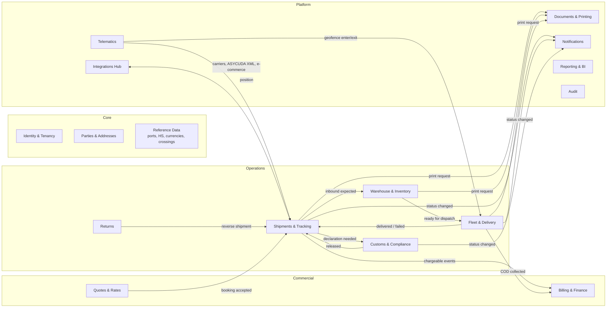
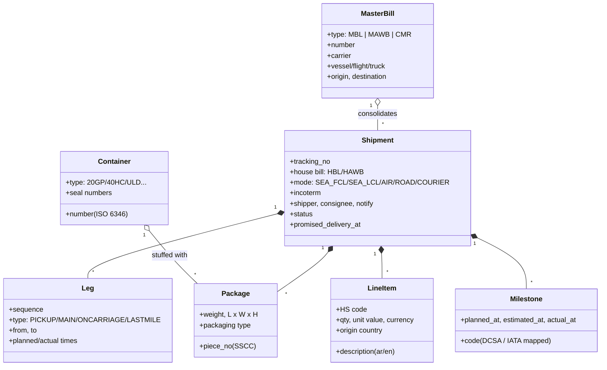
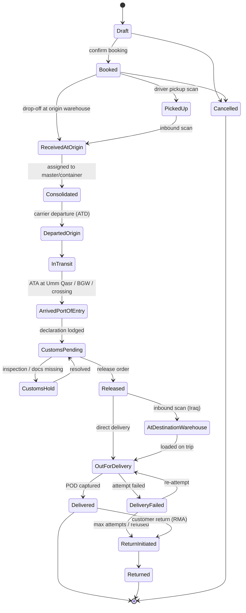

# 02 — Domain Model & Modules

## 1. Bounded contexts (modules)

Each module owns its tables (its own PostgreSQL schema), its domain logic and its public contract. Modules talk to each other **only** through their `Contracts` (queries and commands) or through **domain events**. They never read each other's tables. This rule is enforced by architecture tests ([03](03-system-architecture.md)).



| Module | Owns | Key aggregates |
|---|---|---|
| **Identity & Tenancy** | Tenants, branches, users, roles, permissions, API clients | `Tenant`, `Branch`, `User`, `Role` |
| **Parties & Addresses** | Customers, consignees, shippers, overseas agents, carriers, brokers, suppliers | `Party`, `Address`, `Contact` |
| **Reference Data** | Countries, ports (UN/LOCODE), airports (IATA), border crossings, HS codes, currencies, FX rates, units, holidays (Gregorian and Hijri) | read-mostly catalogues, effective-dated |
| **Quotes & Rates** | Rate cards, surcharges, quotes | `RateCard`, `Quote` |
| **Shipments & Tracking** | Bookings, shipments, legs, packages, masters, containers, milestones, events | `Shipment`, `MasterBill`, `Container` |
| **Customs & Compliance** | Declarations, items, documents (CoO, invoice, COC), duty estimates, sanctions and DG screening | `Declaration`, `ComplianceCase` |
| **Warehouse & Inventory** | Warehouses, zones, locations, SKUs, lots, stock ledger, tasks | `Warehouse`, `InboundOrder`, `OutboundOrder`, `StockLedger` |
| **Fleet & Delivery** | Vehicles, drivers, trips, routes, stops, POD, COD | `Vehicle`, `Driver`, `Trip`, `DeliveryAttempt` |
| **Returns** | RMAs, inspections, dispositions | `ReturnAuthorization` |
| **Billing & Finance** | Charges, invoices, payments, COD remittances, agent settlements | `Invoice`, `Payment`, `CodRemittance` |
| **Documents & Printing** | Templates (labels, invoices, manifests), generated documents, print jobs, printers | `Template`, `PrintJob`, `Printer` |
| **Telematics** | Devices, positions, geofences, trips detected from GPS | `Device`, `Geofence` |
| **Notifications** | Channels (WhatsApp, SMS, email, push), templates, subscriptions, delivery logs | `NotificationRule` |
| **Integrations Hub** | Connectors (carriers, ASYCUDA XML, e-commerce, accounting), webhooks, partner API keys | `Connector`, `WebhookSubscription` |
| **Audit** | Immutable, hash-chained log of all changes and sensitive reads | `AuditEntry` |

## 2. Shipment structure



- A **Shipment** is the customer-facing unit (one house bill, one tracking number).
- A **MasterBill** (MBL for sea, MAWB for air, CMR for road) groups many shipments under one carrier contract. This is consolidation.
- **Packages** are the physical pieces. Each gets an **SSCC-18** barcode (GS1) or an internal piece barcode.
- **Legs** model the multi-modal route. Each leg can have its own carrier, vehicle or master bill.
- **LineItems** carry commercial and customs data (HS code, value, origin) and feed the declaration.

## 3. Shipment lifecycle



- Status is **derived from events**. Every scan, GPS geofence crossing, carrier update or customs response is appended to `shipment_events`. The current status is a projection. A late-arriving or out-of-order event never corrupts the history.
- **Exceptions** (`OnHold`, `Damaged`, `Lost`, `AddressIssue`, `PaymentPending`) are **flags**, not states. They can apply in any state and drive alerts.
- Milestone codes map to **DCSA** ocean events (e.g., `LOAD`, `DEPA`, `ARRI`, `DISC`, `GTOT`) and **IATA Cargo-IMP/ONE Record** air statuses (`RCS`, `MAN`, `DEP`, `ARR`, `RCF`, `NFD`, `DLV`), so carrier feeds plug in without translation tables.

## 4. Delivery-time (SLA) management

Every shipment carries a **milestone plan** built when it is booked:

1. The **lane template** (e.g., `CN-SHA → IQ-UQR → BGW-city`, sea LCL) defines expected durations per leg. These come from historical medians plus a buffer.
2. The **calendar** applies: Friday/Saturday weekend, Iraqi public holidays, Eid dates (Hijri, effective-dated), port closures.
3. The **promise date** is the end of the plan. It is shown to the customer and frozen.
4. The **ETA** is recalculated continuously from actual milestones, vessel/flight ETAs, live GPS and current customs dwell time at that port.
5. **Exception rules** compare ETA with the promise. Examples: "ETA slipped more than 24 h", "no event for 72 h", "in customs more than 5 days", "out for delivery more than 8 h". Rules raise alerts, create tasks and notify customers.

KPIs: on-time delivery %, average and p90 lane transit time, customs dwell per port, first-attempt delivery success, POD capture rate.

## 5. Business rules worth fixing early

| Rule | Detail |
|---|---|
| **Chargeable weight** | `max(actual, volumetric)`. Volumetric = L×W×H (cm) / divisor. Divisor: **air 6000**, **courier 5000**, **road 3000** (configurable per rate card). **Sea LCL:** W/M with 1 CBM = 1,000 kg. |
| **Tracking number** | `LX` + 2-digit year + 8-digit sequence + check digit (mod-10), e.g., `LX26000123457`. Sequences are per tenant. The check digit catches mistyped numbers. |
| **Package IDs** | GS1 **SSCC-18** when the company has a GS1 prefix (GS1 Iraq); otherwise an internal Code 128 piece ID `LX26000123457-003`. |
| **Container numbers** | Validated with the **ISO 6346** check digit. |
| **Money** | Always amount + ISO 4217 currency. **USD and IQD** are first-class. FX rates are dated, and every invoice stores the rate it used. |
| **Addresses in Iraq** | Postal codes are rarely used. The model is governorate → district → area/neighbourhood → nearest landmark → free text, plus a **GPS pin** and **phone number** (the phone is the real key for last-mile delivery). Every address has Arabic and Latin forms. |
| **COD** | Amount, currency, collected-by driver, collected-at, remitted-in batch. COD is a liability until remitted. |
| **Incoterms 2020** | Drive who pays which charges and who is the customs declarant |
| **Dangerous goods** | UN number, class, packing group. Blocks air booking unless DG-approved (IATA DGR); sea uses IMDG. |
| **Document numbering** | Invoices use **gapless** per-tenant/year counters. Operational references (tracking, tasks) may have gaps. |

## 6. Warehouse & inventory model (essentials)

- **Stock is a ledger.** `inventory_transactions` is append-only (receive, putaway, move, pick, adjust, count). Balances are a projection keyed by `(owner, sku, location, lot, status)`.
- **Owner-aware (3PL).** The same SKU can belong to different client companies. Stock never mixes across owners.
- **Status buckets:** `available`, `reserved`, `quarantine`, `damaged`, `bonded` (customs not yet cleared), `in_transit`.
- **Bonded and free-zone stock** (e.g., Khor Al-Zubair) is tracked against its customs regime and declaration, and released only when cleared.
- **Strategies:** FEFO for expiring goods, FIFO by default, fixed pick faces optional.
- **Tasks** drive the mobile app: `ReceiveTask`, `PutawayTask`, `PickTask`, `PackTask`, `CountTask`, `LoadTask`. Each task is a scan-confirm sequence.

## 7. Fleet & delivery model (essentials)

- **Trip** = vehicle + driver(s) + ordered **stops**. Each stop has one or more pickups or deliveries.
- **Delivery attempt** = outcome (`delivered`, `refused`, `not_home`, `wrong_address`, `damaged`) + POD (signature, photo, OTP code, receiver name and ID) + GPS stamp + COD collection.
- **Geofences** around warehouses, ports, border crossings and customer sites trigger milestones automatically (e.g., "arrived Safwan border").
- **Vehicle documents** (registration, insurance, permits) and **driver licences** have expiry alerts.

## 8. Returns model

What is built today for domestic parcels (return to the seller after failed attempts, refusal or a customer request) is described in §10.3. The full model below is the target for 3PL and international returns.

`ReturnAuthorization` (reason, requested by, original shipment) → creates a **reverse shipment** (same engine as forward). On receipt: **inspection** (grade A/B/C/scrap) → **disposition** (restock, refurbish, return to supplier, dispose, re-export). International returns may need a re-export declaration, which links to the Customs module. Charges and refunds flow to Billing.

## 9. Domain events (initial catalogue)

```
shipment.booked                shipment.package_scanned        shipment.milestone_reached
shipment.status_changed        shipment.exception_raised       shipment.eta_changed
customs.declaration_prepared   customs.declaration_lodged      customs.released   customs.hold_placed
wms.inbound_received           wms.stock_moved                 wms.order_picked   wms.order_packed
tms.trip_dispatched            tms.stop_arrived                tms.delivery_attempted   tms.cod_collected
telematics.position_received   telematics.geofence_entered     telematics.geofence_exited
billing.invoice_issued         billing.payment_received
docs.print_requested           docs.print_completed            docs.print_failed
returns.authorized             returns.received                returns.disposed
```

Events are versioned (`shipment.booked.v1`). Each carries `tenant_id`, `event_id` (UUIDv7), `occurred_at`, `correlation_id` and `causation_id`.

## 10. Domestic delivery across Iraq (built)

The first product is last-mile delivery for online sellers (Instagram and web shops) across all 18 governorates. This is how it works in the code today (`src/Modules/Shipments`).

### 10.1 Hub network (warehouses are data)

Each company manages its own **warehouses** on the warehouses page: sorting hubs, branches and fulfilment stores, each with a three-letter **routing tag** (printed on labels), a governorate, a map position, contact details, an optional shelf capacity, and the governorates it **covers**. A governorate is covered by exactly one active warehouse; moving coverage from one warehouse to another is an explicit, confirmed step. Exactly one warehouse is the company's main hub, and warehouses are retired, never deleted, so history keeps its meaning.

A new company starts with the standard network below (`IraqHubs.Standard`); after that, `HubNetwork` is built from the company's own `Warehouse` rows (`HubDirectory` on the server, `HubCatalog` in the browser), so routing, labels, the map and every hub picker follow the company's real branches.

| Standard hub | Code | Serves |
|---|---|---|
| Baghdad Central Hub | `HUB-BGW` | Baghdad, Anbar, Diyala, Salah ad-Din, Wasit |
| Basra Southern Hub | `HUB-BSR` | Basra, Dhi Qar, Maysan, Muthanna |
| Erbil Northern Hub | `HUB-EBL` | Erbil, Sulaymaniyah, Duhok, Kirkuk |
| Najaf Mid-Euphrates Hub | `HUB-NJF` | Najaf, Karbala, Babil, Qadisiyah |
| Mosul Nineveh Hub | `HUB-MOS` | Nineveh |

Hub codes are `HUB-` plus the routing tag. Every parcel carries four hubs: **origin** (the seller's), **destination** (the customer's), **current** (where it is now) and **target** (where it must go next; the seller's hub when it is returning). `HubNetwork` resolves governorate → hub and the transit hours between hubs.

Domestic lifecycle: `Booked → PickedUp → AtWarehouse → (InTransitToHub → AtWarehouse)* → OutForDelivery → Delivered`, with `DeliveryFailed` back to `OutForDelivery`/`AtWarehouse`, and the return path `ReturnInitiated → ReturnInTransit → ReturnAtHub → Returned`. Line-haul statuses are set only by truck scans, never by hand.

### 10.2 Line-haul trucks (`HubTransfer`, `TR-YYYY-NNNNNN`)

- A parcel received at a hub that is not its target is **planned** on the open truck for that lane (created if needed) when *auto plan trucks* is on.
- Truck states: `Loading → InTransit → Received`. Item states: `Planned → Loaded → Received`, or `Missing` when the truck is closed without that parcel being unloaded.
- Loading, departing and unloading are scans at the hub station or on the truck page. Unloading at the right hub moves the parcel to `AtWarehouse` there; scanning a parcel at the wrong hub raises a *misrouted* alert.
- Every scan (success or refusal) is stored in `hub_scans`, which feeds the hub radar and the hub station's daily numbers.

### 10.3 Returns (`RM-YYYY-NNNNNN`)

- A return starts **automatically** after the last allowed failed attempt (*max attempts*, default 3) or on refusal (*return on refusal*), or by staff, or from an approved customer return request.
- The parcel travels back on trucks to the seller's hub (`ReturnInTransit`), waits there (`ReturnAtHub`), and is handed to the seller in a batch that produces a **return manifest** (who received it, when, which parcels). Cash on delivery is never collected on a returned parcel.
- The returns screen groups waiting parcels by seller and hub, shows what is still on the way back, and charts return reasons.

### 10.4 Customer requests (`ServiceRequest`, `RQ-YYYY-NNNNNN`)

| Type | Allowed while | Applied automatically when |
|---|---|---|
| Reschedule | Not yet out for delivery, or after a failed attempt | Always (Fridays are refused) |
| Change phone | Same | Always |
| Change address | Same | The new address is in the same governorate |
| Cancel | Same | The parcel has not been collected yet (`Booked`) |
| Return | Up to 7 days after delivery | Never (staff decide) |
| Complaint | Any time | Never |

Customers send requests from the public tracking page after entering the **last four digits** of the order's mobile number (rate-limited per client address; five wrong answers lock the order's self-service for 24 hours; no personal data shown). Sellers and staff can record them too. Anything not applied automatically lands in the requests inbox with an SLA.

### 10.5 Automation engine

Each company has an `AutomationPolicy` (editable on the automation page, versioned with ETag):

| Setting | Default | Effect |
|---|---|---|
| Max delivery attempts | 3 | Last failed attempt starts the return |
| Return on refusal | on | A refused parcel starts the return immediately |
| Auto reschedule | on | A failed attempt gets the next working day (Friday skipped) |
| Auto plan trucks | on | Parcels are planned on the right truck when received |
| Auto apply customer requests | on | §10.4 |
| Notify customers | on | Queues WhatsApp messages (out for delivery, failed, rescheduled, delivered, return started, request received) |
| SLA hours | pickup 24, shelf 48, with courier 12, truck grace 6, request 24; return collection 5 days | Thresholds for alerts |

The **sweep** (`AutomationEngine`, run every minute by `AutomationWorker` for every company, one runner at a time through a PostgreSQL advisory lock) raises alerts — pickup overdue, too long on the shelf, with the courier too long, delivery date missed, truck late, missing from a truck, misrouted, return not collected, request overdue — and **resolves them by itself** when the cause is gone. Everything it does is written to the automation log, so staff can see why a parcel moved.

### 10.6 Order confirmation (cash on delivery)

Refused cash-on-delivery parcels are the most expensive failure for a delivery company, so orders can wait for the customer's confirmation before pickup. The company chooses who must confirm (`OrderConfirmationMode`): nobody, **risky customers** (medium or high return risk, §10.8), or every order.

- A held order is `Booked` with confirmation `Pending`. The customer confirms or declines on the tracking page (last four digits of the mobile required), or staff record a call: confirmed, no answer (attempts are counted), or declined (the order is cancelled with the reason).
- The confirmation queue shows waiting orders with the customer's history; the automation sweep raises a *confirmation overdue* alert after the company's limit and, if the company set one, cancels orders that were never confirmed.

### 10.7 Pricing (rate card)

Each company has a `RateCard` (IQD): a price inside the seller's own governorate, a price per destination governorate (with a default), a weight allowance with a charge per extra kilogram, and a percentage discount for chosen sellers. Fees round to 250 IQD. The order form and the server quote from the same card, so the fee a seller sees is the fee that is booked; staff can still override a fee on an order.

### 10.8 Customer history and risk

Typing a mobile number on the order form looks the customer up across the company's history: orders delivered, returned and refused, failed attempts, last address. `CustomerRiskRules.Assess` turns that into `New`, `Low`, `Medium` or `High` (for example two refusals, or half of at least three finished orders coming back, is high). The risk drives order confirmation and is shown wherever staff deal with the customer.

### 10.9 Editing and cancelling orders

Domestic orders can be corrected (customer, phone, address, governorate, items, COD, fee, notes) until they are out with a courier; changing the governorate re-routes the parcel. Every change is written to the timeline as one event listing what changed. Orders that have not been collected can be cancelled with a reason; later, "cancel" means starting a return.

### 10.10 Delivery ratings

For 14 days after delivery the customer can rate it from 1 to 5 stars on the tracking page (last four digits of the mobile required), with an optional comment. A rating of 2 stars or fewer opens a complaint in the requests inbox automatically. Ratings feed the dashboard and each courier's average.

### 10.11 Dashboard and analytics

`/api/v1/analytics/overview` compares a period (today, 7, 30 or 90 days) with the one before: orders booked and delivered, success rate, first-attempt rate, on-time rate, average delivery time, return rate, COD collected and customer rating, plus daily volume (cut in Baghdad time), top sellers, governorates, couriers and failure reasons. All aggregation runs in PostgreSQL.
