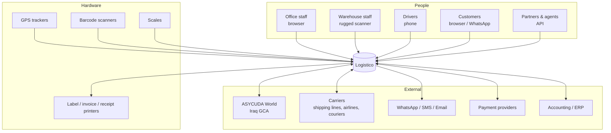
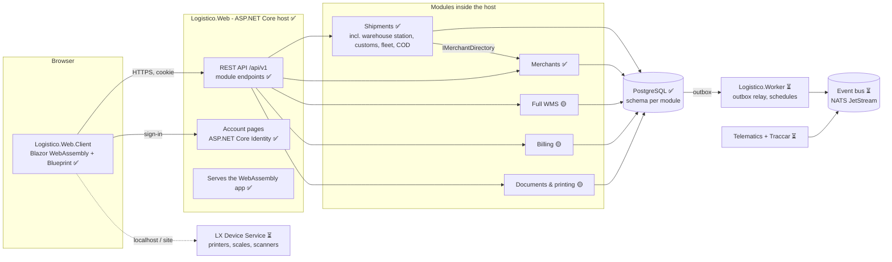

# 03 — System Architecture

Legend: ✅ decided and implemented · 🟡 decided, not built yet · ⏳ proposed, open for discussion (not adopted).

## 1. Principles

1. **Modular monolith first.** One ASP.NET Core deployable with strict module boundaries. A module becomes its own service only when it has a measured, different scaling or availability profile; GPS telematics and carrier integrations are the likely candidates.
2. **PostgreSQL is the source of truth.** Caches, search indexes and analytics stores are rebuildable projections.
3. **The browser runs the UI; the server owns the rules.** Blazor WebAssembly renders everything client-side and calls a REST API. Every rule is enforced on the server, even when the browser also checks it for speed.
4. **Events for side effects, calls for answers.** A module asks another module through its contract. It announces what happened through events (transactional outbox, phase 1+).
5. **Offline is a normal state at the edges.** Warehouses, ports and drivers must keep working through outages (edge nodes and mobile apps, phase 2).
6. **Hardware lives at the edge.** The cloud never talks to a printer directly. It sends a *print job* to the site's device service.
7. **Boring, licence-safe, long-term-supported components.** LTS runtimes; no dependency that can change its licence under us without an exit plan.

## 2. System context



## 3. Containers



| Container | Tech | Responsibility | Status |
|---|---|---|---|
| **Logistico.Web** (host) | ASP.NET Core 10 | Serves the WebAssembly app and the account pages; hosts every module's REST endpoints; cookie authentication | ✅ |
| **Logistico.Web.Client** | Blazor WebAssembly, Blueprint 6 CSS + own components | The whole UI in Arabic and English: shell, tables, forms, labels; typed API clients | ✅ |
| **Modules** | Class libraries loaded by the host | Domain logic + persistence + endpoints per bounded context | Shipments ✅, Merchants ✅, others 🟡 |
| **PostgreSQL** | PostgreSQL 16+ (18 in CI/production) | All business data, schema per module | ✅ |
| **Logistico.Worker** | .NET generic host | Outbox relay, scheduled jobs (ETA, SLA rules, FX import), long-running exports | ⏳ |
| **Event bus** | NATS JetStream (proposed) | Events between modules/services; leaf nodes at sites | ⏳ |
| **Telematics + Traccar** | .NET + Traccar (Apache 2.0) | GPS protocol decoding and position processing | ⏳ |
| **LX Device Service** | .NET 10 Native AOT | Local printing, scales, scanners for browser users; site edge agent | ⏳ |

## 4. Solution structure (as built)

```
src/
├─ Logistico.Web/                         Host (composition root)
│  ├─ Program.cs                          Identity, cookie auth, localisation, rate limiting, module registration
│  ├─ Components/                         App.razor (Blueprint CSS, fonts, RTL), account pages (server-rendered)
│  ├─ Data/                               ApplicationUser, Identity DbContext (schema "iam"), claims factory
│  ├─ Endpoints/AccountEndpoints.cs       /api/v1/account/me, /logout for the browser client
│  ├─ Infrastructure/                     Tenant context, database initializer (migrate + seed),
│  │                                       localisation (ar-IQ default, /culture switch), security headers
│  └─ wwwroot/                            app.css (design tokens, logical properties, phone layout), js/lx.js,
│                                          vendored Blueprint (LTR + RTLCSS-generated RTL) and Almarai in lib/
├─ Logistico.Web.Client/                  Blazor WebAssembly UI
│  ├─ Layout/                             MainLayout (top bar, side menu with live counters, hub radar), command palette,
│  │                                       shortcut sheet, PublicLayout
│  ├─ Pages/                              Home, Network map, Shipments (list, new order, new international, details, labels),
│  │                                       Hub station, Trucks, Returns, Requests, Automation, Merchants, Customs, Fleet,
│  │                                       Finance & COD, Public/Track (with customer requests)
│  ├─ Ui/                                 Blueprint component kit (Button, Tabs, DataTable, Pager, Dialog, Drawer, KpiCard,
│  │                                       Timeline, HubJourney, …), Map/ (Iraq SVG map), Bidi, Plural, Fmt
│  ├─ Services/                           ShipmentsApi, OperationsApi, MerchantsApi, AccountApi, OpsState, ApiErrors
│  └─ Resources/                          UiText.resx / UiText.ar.resx
├─ Logistico.SharedKernel/                Tenancy, DomainException, paging, claim types, AppCultures (ar/en formats),
│                                          Iraq/ (governorates, phone numbers), shared texts
└─ Modules/
   ├─ Shipments/
   │  ├─ Logistico.Modules.Shipments/     internal: Domain/ (Shipment, events, HubTransfer, ServiceRequest, alerts,
   │  │                                    automation log, notifications, customs declaration, courier, COD settlement),
   │  │                                    Application/ (WarehouseScanner, TransferPlanner, ReturnDesk, RequestDesk,
   │  │                                    AutomationEngine + AutomationWorker), Infrastructure/ (DbContext, migrations,
   │  │                                    search, number sequences), Endpoints/
   │  │                                    public: ShipmentsModule (the only entry point)
   │  └─ Logistico.Modules.Shipments.Contracts/   DTOs, requests (validation), Rules/ (lifecycle, tracking stages,
   │                                              delivery promise, hubs, automation policy, request rules,
   │                                              Code-128, duties, chargeable weight)
   └─ Merchants/
      ├─ Logistico.Modules.Merchants/     internal: sellers (Instagram / online shops), DbContext (schema "merchant")
      └─ Logistico.Modules.Merchants.Contracts/   DTOs and IMerchantDirectory (how other modules look up sellers)
```

**Two projects per module:**
- **`Logistico.Modules.X`**: everything internal (domain, EF Core, endpoints). The single public type is `XModule`, which offers `AddXModule()`, `MapXModule()` and migration/seed helpers.
- **`Logistico.Modules.X.Contracts`**: the published language. DTOs, request models with validation attributes, enums, and pure rules (state machine, calculators) that run **identically in the browser and on the server**. No server dependencies.

**Rules enforced by architecture tests** (`tests/Logistico.ArchitectureTests`):
- Contracts do not reference EF Core, ASP.NET Core, Npgsql or the module implementation.
- The browser client references only contracts, never module implementations, EF Core or the host.
- Modules do not reference the host.
- A module exposes only its entry point (plus EF migrations) as public types.

## 5. Communication patterns

| Need | Pattern | Tech | Status |
|---|---|---|---|
| Browser → server | REST/JSON over HTTPS, same origin, cookie auth | ASP.NET Core Minimal APIs | ✅ |
| Lists (search/filter/sort/paging/totals) | Query-string parameters → LINQ → SQL; one page per request | `ShipmentQuery` contract + `ShipmentSearch` (server), `Pager` (client) | ✅ |
| Hub radar, side-menu counters | Browser polls every 5 s | Persistent scan log (`hub_scans`) and SQL counters; works with several servers | ✅ |
| Automation (returns, rescheduling, truck planning, alerts) | In-process sweep every minute per company | `AutomationWorker` hosted service; PostgreSQL advisory lock so only one server runs a company's sweep | ✅ |
| Who am I | `GET /api/v1/account/me` | Custom `AuthenticationStateProvider` in the client | ✅ |
| Server → browser live updates | WebSocket push | SignalR | 🟡 Phase 1 |
| Module → module question | In-process contract call | Interfaces in Contracts (e.g. `IMerchantDirectory`) | ✅ |
| Module → world "something happened" | Transactional outbox → event bus | Outbox table + relay | ⏳ |
| Cloud → site hardware | Request/reply to the site's device service | Event bus subject `site.<id>.print` | ⏳ |
| Partners | REST + signed webhooks (HMAC-SHA256) | API keys / OAuth client credentials | 🟡 Phase 4 |

### API conventions (implemented)

- Base path `/api/v1/...`. Route strings live in `*Contracts/*ApiRoutes.cs` and are shared by server and client.
- Errors are **RFC 9457 Problem Details**. Rule violations return **422** with a stable `code` (e.g. `shipment.invalid_transition`). Validation errors return **400** with field errors.
- **Optimistic concurrency:** `GET` returns an `ETag` (PostgreSQL `xmin`). State-changing calls require `If-Match`: missing → **428**, stale → **412**.
- API calls never redirect to the login page: unauthenticated → **401**, forbidden → **403**.
- Enums travel as **strings** (`"CustomsPending"`) for readable partner payloads.
- Timestamps are ISO-8601 UTC; the UI shows local time (`Asia/Baghdad`, UTC+3).
- OpenAPI 3.1 document at `/openapi/v1.json` (development).
- Public tracking is rate-limited (60 requests per minute per IP) and returns no personal data. Customer requests from the tracking page need the phone's last 4 digits and are limited to 10 per 10 minutes per IP.
- Texts in errors follow the request language (`Accept-Language`, `ar-IQ` by default).
- 🟡 Next: `Idempotency-Key` on create endpoints.

## 6. Technology stack

| Concern | Choice | Status |
|---|---|---|
| Runtime | **.NET 10 LTS** (C# 14), SDK pinned in `global.json` | ✅ |
| Web framework | ASP.NET Core Minimal APIs; built-in OpenAPI | ✅ |
| UI | **Blazor WebAssembly** + **Blueprint 6** CSS and icons with Logistico's own components ([08](08-ui-ux-design-system.md)) | ✅ |
| Languages | `IStringLocalizer` + resx (ar-IQ default, en-US); `AppCultures` for number and date formats | ✅ |
| ORM | **EF Core 10** + Npgsql; `EFCore.NamingConventions` (snake_case) | ✅ |
| Identity | **ASP.NET Core Identity** (cookies, roles, 2FA, passkeys) | ✅ |
| Validation | DataAnnotations on contract requests (browser + server) | ✅ |
| Package management | Central Package Management + transitive security pins | ✅ |
| Tests | xUnit, `WebApplicationFactory`, real PostgreSQL | ✅ |
| Labels / printing | HTML 4×6" labels with Code-128 barcodes printed from the browser | ✅ |
| Reporting / PDF | To decide (open-source or commercial PDF engine) | ⏳ |
| Realtime | SignalR | 🟡 Phase 1 |
| Event bus | NATS JetStream | ⏳ |
| Cache | Valkey | ⏳ |
| Background jobs | .NET hosted services (automation sweep ✅); Wolverine (MIT) if needed | 🟡 |
| GPS gateway | Traccar | ⏳ |
| Telemetry store | TimescaleDB | ⏳ |
| Network map | Built-in SVG of the 18 governorates (geoBoundaries, CC0), hubs and truck lanes | ✅ |
| Live vehicle maps / routing | MapLibre + self-hosted Iraq tiles; Valhalla | ⏳ |
| Observability | OpenTelemetry → Grafana stack | 🟡 Phase 1 |
| Deployment | Container image (SDK-built, chiseled Ubuntu); Kubernetes + Argo CD | Image ✅ in CI, platform ⏳ |

## 7. Performance engineering

**Database access**
- Every list screen is **server-side**: paging, sorting, filtering and totals run in SQL. The browser never downloads full tables. (Implemented for shipments, trucks, requests, alerts, automation log, customs queue, warehouse stock and sellers.) Fleet and finance totals are SQL aggregates.
- Document numbers (`TR-`, `RQ-`, `RM-`, `STL-`) come from PostgreSQL sequences, so parallel requests never collide.
- "Contains" search on customer and seller names uses `pg_trgm` GIN indexes; tracking number and phone use normal B-tree indexes.
- Flat read projections built for screens (`ShipmentProjections.ToListItem`), `AsNoTracking()` for reads, no N+1.
- Indexes match screen filters: `(tenant_id, status, eta_at)`, `(tenant_id, created_at)`, unique `(tenant_id, tracking_number)`.
- Total counts on very large tables will use capped or estimated counts when needed.
- Reports and BI on a read replica (phase 2+).

**API**
- Minimal APIs with typed results, `System.Text.Json`, response compression at the gateway.
- Output caching for reference data (ports, HS codes) once those modules exist.

**Browser**
- WebAssembly assets are fingerprinted and cached (`MapStaticAssets`). Repeat visits load from cache.
- Tables show one page at a time (25 rows by default). Blueprint CSS, icons and fonts are served from the app itself, not a CDN.
- No prerendering: components never run twice, and the server never renders UI for API users.

## 8. Multi-tenancy (implemented)

- Every business row has `tenant_id`. The tenant comes from the signed-in user's claim (`logistico:tenant_id`), which is added to the cookie at sign-in.
- EF Core **global query filters** restrict every query to the current tenant. An integration test proves one tenant cannot read another tenant's shipment.
- Public tracking deliberately bypasses the filter: tracking numbers come from one global sequence, and only non-personal fields are returned.
- 🟡 Next: PostgreSQL row-level security as defence in depth ([04](04-database-design.md) §5), and branch-level data scopes.

## 9. AI-assisted features (phase 4, optional)

- **Document extraction:** commercial invoices and packing lists (PDF/photo) → structured line items → a human confirms → declaration items.
- **HS code suggestion** from item descriptions (Arabic, English, Chinese), always confirmed by a broker.
- **Exception triage:** summarise why a shipment is late from its event history.

These use a hosted large language model behind the Integrations module with strict data minimisation. Nothing is submitted to customs without human approval.
