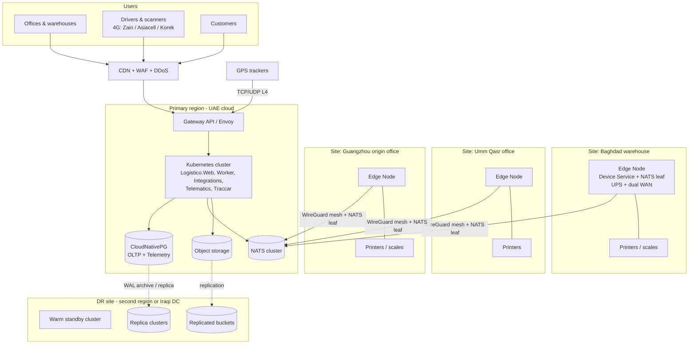

# 05 — Infrastructure & Deployment

> **Status:** proposed. Hosting region, Kubernetes and the edge-node design are open for discussion ([13](13-roadmap.md); go-live requirements in [15](15-production-readiness.md)). What exists today: CI builds a container image of `Logistico.Web` and EF Core migration bundles ([11](11-ci-cd-and-devops.md)).

## 1. The Iraq constraints that drive everything

| Constraint | Consequence |
|---|---|
| No hyperscaler region inside Iraq; nearest are UAE (and Bahrain) | Core runs in a UAE region at first. Latency from Baghdad/Basra is typically tens of ms, which is fine for APIs; hardware stays local. |
| Data-localization rules undefined; government DCs (Nokia, 2025) and the first commercial Tier III DC (end 2026) are coming | **Portable Kubernetes.** The same charts must run in UAE cloud, an Iraqi DC or on-prem with no code changes. |
| Unstable power, ISP outages, government internet shutdowns during national exams | **Site edge nodes** and **offline-first clients**. Sites must work ≥ 72 h without the cloud. |
| Mixed hardware (USB, network and serial printers; rugged scanners; many GPS brands) | All hardware access goes through the local **LX Device Service** ([06](06-device-integration.md)) |
| Offices abroad (China, Turkey, UAE) | Same platform. Origin offices are just more sites with edge nodes. |

## 2. Deployment options

| Option | Description | Pros | Cons | When |
|---|---|---|---|---|
| **A. Cloud (UAE region)** | Managed Kubernetes (EKS in `me-central-1` or AKS in UAE North) | Fast to start, managed services, good SLAs | Data outside Iraq | **Phase 0–2 default** |
| **B. Iraqi data centre** | Colocation or government DC, self-managed Kubernetes (RKE2/Talos) | Data residency, close to users | We operate more; DC maturity varies | When the law or a customer requires it |
| **C. Hybrid (recommended long-term)** | Core in A or B; **edge nodes at every site**; DR in the other | Resilient, compliant, fast hardware | Most moving parts | **Target architecture** |

Everything is defined as code (OpenTofu + Helm + Argo CD), so moving from A to B is a redeploy plus a data migration, not a rewrite.

## 3. Target topology



## 4. Kubernetes platform

| Concern | Choice |
|---|---|
| Distribution | Managed (EKS/AKS) in cloud; **RKE2** or **Talos Linux** in an Iraqi DC |
| GitOps | **Argo CD** (app-of-apps per environment), **Argo Rollouts** for canaries |
| Ingress | **Gateway API** with **Envoy Gateway** (ingress-nginx is being retired) |
| L4 for GPS | Dedicated TCP/UDP load balancer listeners, one port per tracker protocol (e.g., Teltonika, GT06/Concox, Queclink, Ruptela) |
| TLS | cert-manager + Let's Encrypt (public) / internal CA (mesh, edge) |
| Secrets | **External Secrets Operator** ← cloud secret manager or **OpenBao** (open Vault fork) |
| Postgres | **CloudNativePG** operator |
| NATS | Official NATS Helm chart, 3-node JetStream cluster |
| Cache | Valkey (Bitnami-free chart or operator), replication + sentinel |
| Object storage | Cloud S3 (A) / **SeaweedFS** or Ceph RGW (B) |
| Policy | **Kyverno**: signed images only, no root, resource limits required, no `latest` tags |
| Autoscaling | HPA (CPU + custom metrics: RPS, NATS consumer lag); Karpenter / cluster autoscaler |
| Backups (cluster state) | **Velero** to object storage |

### Namespaces and node pools

```
namespaces:  lx-core (web host, worker, integrations)   lx-telematics (traccar, telematics)
             lx-data (cnpg, nats, valkey)
             lx-observability   lx-system (gateway, cert-manager, eso, kyverno, argocd)

node pools:  system   – 3× 4 vCPU / 16 GB
             app      – 3–12× 8 vCPU / 32 GB (autoscaled)
             data     – 3× 16 vCPU / 64 GB, local NVMe (tainted; DB + NATS only)
             telem    – 2–6× 8 vCPU / 16 GB (autoscaled on ingest lag)
```

## 5. Site edge node

A small, fanless industrial PC at every warehouse, port office and origin office.

| Item | Spec |
|---|---|
| Hardware | x86 mini-PC, 4–8 cores, 16 GB RAM, 512 GB SSD, 2× Ethernet; second unit for large sites |
| Power | Online UPS (≥ 2 h) + generator input; auto power-on after outage |
| Network | Dual WAN: fibre + 4G/5G router (different carriers), auto-failover |
| OS | Linux (Ubuntu LTS or Talos) running **k3s** or Docker Compose (pinned, signed images) |
| Software | **LX Device Service** in site mode (.NET 10 Native AOT): print spooler, printer discovery, serial/scale reader, scanner hub · **NATS leaf node** (proposed): buffers events while offline · Local read cache for the site's working set (today's shipments, tasks, labels) |
| Connectivity to core | **WireGuard** mesh (NetBird or Headscale control plane); no inbound ports open at the site |
| Management | Remote updates through GitOps channel; health reported to Grafana; watchdog reboots |

**Offline behaviour:** clients at the site fall back to the edge node for printing and cached reads. Scans and status updates queue in the NATS leaf and in client SQLite, then replay in order when the WAN returns. Each event carries its original `occurred_at`, so history stays correct.

## 6. Environments

| Env | Purpose | Data | Deployed by |
|---|---|---|---|
| **local** | Developer laptop | Seeded demo data | `dotnet run --project src/Logistico.Web` against local PostgreSQL (Aspire orchestration later, when more services exist) |
| **preview** | One per pull request (namespace) | Seeded fakes | CI on PR open; auto-deleted on merge/close |
| **dev** | Integration of `main` | Synthetic | Argo CD auto-sync on merge |
| **staging** | Release candidate, production-like, hardware lab connected | Anonymised production snapshot | Argo CD auto-sync of release tags |
| **production** | Live | Real | Promotion PR + manual approval + canary |
| **dr** | Warm standby | Replicated | Continuous replication; failover runbook |
| **hardware lab** | Real printers, scanners, scales, GPS units, a test edge node | Synthetic | Connected to staging |

## 7. Networking & security perimeter

- **CDN/WAF/DDoS** in front of everything public (web app, API, tracking site). Choose a provider with in-region points of presence.
- Public endpoints: `app.` (web app, API and sign-in, one origin), `track.` (public tracking, optional alias), `gps.` (L4 tracker ports, no CDN).
- Private only: databases, NATS (except leaf-node port over WireGuard), Traccar admin, Argo CD, Grafana (behind SSO).
- **Egress allow-list** for integrations (carriers, WhatsApp, SMS gateways, e-payment providers).
- mTLS service-to-service where it crosses trust zones (edge ↔ core is WireGuard plus NATS TLS with per-site credentials).

## 8. Initial production sizing (Year 1)

| Component | Replicas | Per replica |
|---|---|---|
| Logistico.Web (API + WebAssembly host) | 3 (HPA 3–12) | 1 vCPU / 1 GB request; 2 vCPU / 2 GB limit |
| Logistico.Worker | 2 | 1 vCPU / 1 GB |
| Logistico.Integrations | 2 | 0.5 vCPU / 512 MB |
| Logistico.Telematics | 2 (HPA on lag) | 1 vCPU / 512 MB (Native AOT) |
| Traccar | 2 | 2 vCPU / 2 GB |
| PostgreSQL OLTP | 3 | 8 vCPU / 32 GB / 500 GB NVMe |
| PostgreSQL Telemetry | 2 | 8 vCPU / 32 GB / 1 TB |
| NATS | 3 | 2 vCPU / 4 GB / 100 GB |
| Valkey | 3 | 1 vCPU / 4 GB |

## 9. Disaster recovery

| Scenario | Response | Target |
|---|---|---|
| Pod/node failure | Kubernetes reschedules; DB replica promoted automatically by CNPG | < 1 min, no data loss |
| Zone failure | Multi-zone node pools and DB replicas | < 5 min |
| Region failure | Promote the DR replica cluster, switch DNS, scale up the DR cluster | **RTO ≤ 30 min, RPO ≤ 5 min** |
| Site WAN outage | Edge node + offline clients continue; replay on reconnect | 72 h autonomy |
| Ransomware / bad deploy | Immutable (object-lock) backups, PITR, Argo CD rollback | PITR to any second in 30 days |

DR is **tested**, not assumed: monthly automated restores, quarterly full failover rehearsal with a written report.
