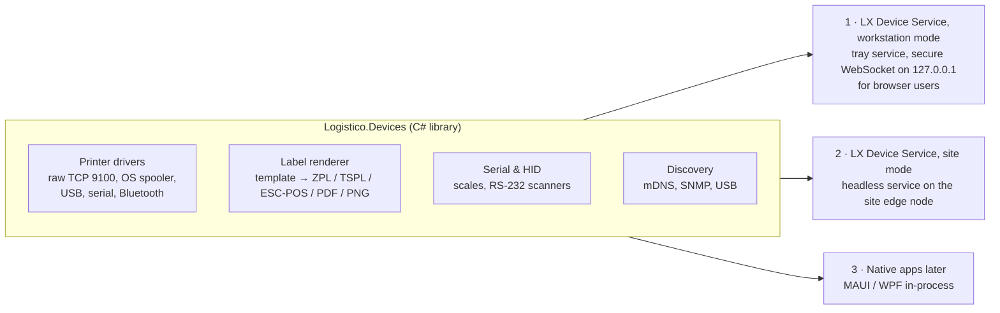
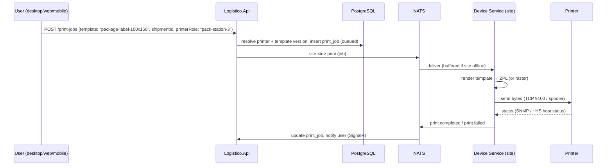
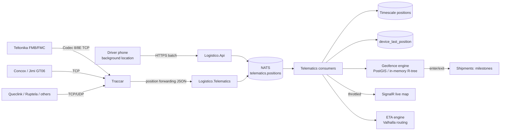

# 06 — Device Integration

GPS trackers, barcode scanners, label printers, invoice printers, receipt printers, scales and dimensioners all connect through one consistent design.

## 1. The device layer (proposed, .NET)

> **Status:** ⏳ proposed. It is open for discussion together with the desktop/mobile approach ([13](13-roadmap.md)).

Browsers cannot reliably reach USB/serial printers, scales or raw TCP printer ports (and Safari supports none of WebUSB/WebSerial). So hardware access lives in one C# library, run in three ways:

| Mode | Used by | How the UI reaches it |
|---|---|---|
| **Workstation mode** | A browser user with a local USB/serial printer or scale | `wss://localhost` with origin checks; each request carries a short-lived token signed by the API (the QZ Tray pattern) |
| **Site mode** | Everyone at a site, plus cloud-initiated jobs (print at another warehouse) | Event-bus request/reply, subject `site.<siteId>.print` |
| **In-process** | Future native desktop/mobile apps | Direct library calls |
| Mobile | Driver/warehouse apps | Platform code in .NET MAUI: Zebra Link-OS (Bluetooth ZPL), ESC/POS over Bluetooth, DataWedge intents |

The service is a **.NET 10 Native AOT** binary: small, fast start, no runtime install. It installs as a Windows Service, a macOS launchd agent or a Linux systemd unit, and auto-updates with signed packages.

**Rule:** the UI never builds printer commands. It submits **print intents** (`template + data + printer role`) and the device layer renders them. Templates are versioned in the Documents module.

## 2. Printing

### 2.1 Printer classes

| Class | Typical hardware (common in Iraq and origin markets) | Languages | Connection |
|---|---|---|---|
| **Label (thermal)** | Zebra ZD/ZT series, TSC TE/TTP, Honeywell PC/PM, Godex, Xprinter label models | **ZPL II**, TSPL/TSPL2, DPL, EZPL | Ethernet (TCP 9100), USB, serial, Bluetooth (mobile ZQ series) |
| **Receipt (thermal 80 / 58 mm)** | Epson TM-T series, Xprinter, Rongta, Sunmi built-in | **ESC/POS** | USB, Ethernet, Bluetooth |
| **Document (A4)** | Any laser printer via OS driver | PDF → OS spooler | Network/USB via Windows/CUPS |
| **Mobile label/receipt** | Zebra ZQ3/ZQ5/ZQ6, Bluetooth ESC/POS printers | ZPL / CPCL / ESC/POS | Bluetooth Classic/LE |

### 2.2 Print pipeline

**Fast path:** when the user's workstation has the Device Service and the printer is reachable, the browser sends the job **locally** (< 300 ms) and reports the result to the API afterwards. The cloud path is for printing at a *different* site (e.g., Baghdad prints labels at the Basra warehouse) and for users without a local service.

### 2.3 Label templates

- **LX Label** templates are a JSON layout DSL: text, barcode, QR, DataMatrix, line, box, image, with data bindings and conditional blocks. A visual **Label Designer** lives in the desktop/web app.
- Renderers: `ZPL`, `TSPL`, `ESC/POS`, `PDF`, `PNG`. Golden-file tests compare the output of each renderer in CI.
- Printer profiles store dpi (203/300/600), media size, darkness, speed, language and Arabic capability.
- Standard templates for Phase 1:
  - `package-label-100x150` (4×6"): tracking barcode (Code 128), SSCC (GS1-128), QR to the tracking page, consignee in Arabic and Latin, COD amount, piece `3/12`, route code
  - `pallet-label-100x150`, `location-label-50x25`, `sku-label-50x30`
  - `receipt-80mm` (COD receipt, drop-off receipt)
  - `invoice-a4`, `manifest-a4`, `delivery-note-a4`, `waybill-a4` (PDF templates, engine to decide, §2.5)

### 2.4 Arabic and Kurdish on thermal printers (critical)

Most thermal printers do **not** shape Arabic script correctly with their built-in fonts. Letters come out disconnected or left-to-right.

| Printer type | Approach |
|---|---|
| Zebra Link-OS printers (ZD/ZT/ZQ, recent firmware) | UTF-8 (`^CI28`) + a downloaded Unicode TrueType font + **advanced text layout (`^PA`)** for shaping and bidi. Validate per model and firmware. ⚠ verify per model |
| Other ZPL/TSPL printers | **Raster fallback:** the bridge shapes text with HarfBuzz (**HarfBuzzSharp + SkiaSharp**, MIT) into a 1-bit bitmap and sends it as a graphic (`^GF` in ZPL, `BITMAP` in TSPL) |
| ESC/POS receipt printers | **Always raster** (`GS v 0`) for Arabic/Kurdish lines. Arabic code pages are inconsistent across vendors. |

The renderer chooses automatically from the printer profile. Raster labels are slower to transmit, so we cache rendered static parts.

### 2.5 Invoices and A4 documents

- **Today:** 4×6" labels are HTML pages with Code-128 barcodes, printed from the browser's print dialog (works with any installed label printer driver).
- **Next:** invoices and A4 documents generated server-side as **PDF** (RTL layouts, Arabic fonts embedded), stored in object storage, then printed through the OS spooler by the Device Service (Windows: `winspool` API; macOS/Linux: CUPS).
- **PDF engine, not chosen yet** (open for discussion): HTML → PDF with headless Chromium (free, reuses our HTML templates, best Arabic shaping) or QuestPDF (C# layouts; commercial licence above $1 M annual revenue). DevExpress Reporting is out while there is no licence.
- Layout customisation: templates are files edited by us at first; a visual designer only if users need one.
- E-invoice QR/verification data can be added when Iraqi e-invoicing rules require it.

## 3. Barcode scanning

### 3.1 Symbologies

| Use | Symbology |
|---|---|
| Tracking number, piece ID | **Code 128** |
| Package/pallet SSCC | **GS1-128** (AI 00) |
| Customer tracking link, driver handover | **QR** |
| Small items, SKU with lot/expiry | **GS1 DataMatrix** (AI 01, 10, 17, 21) |
| Retail product codes | EAN-13 / UPC-A |
| Location labels | Code 128 with a check character |

The GS1 Application Identifier parser lives in a shared C# contracts library used by the browser (WebAssembly), the Device Service and the mobile apps, so scans mean the same thing everywhere.

### 3.2 Input methods per platform

| Platform | Scanner type | Integration |
|---|---|---|
| Browser | USB HID "keyboard wedge" | Global scan listener: detect bursts (< 30 ms between keys) with configured prefix/suffix (e.g., `STX…ETX` or `Enter`), route the scan to the focused workflow, never into a random text field |
| Workstation | Serial / virtual COM scanners | Device Service (`System.IO.Ports`) |
| Browser | Bluetooth ring/handheld scanners | HID mode = same as USB; SPP mode = serial |
| Rugged Android (Zebra TC/MC, Honeywell CT/CK) | Built-in imager | **Zebra DataWedge** broadcast intents (`com.symbol.datawedge.ACTION_BARCODE_SCANNED`), Honeywell Data Collection intents; profile auto-provisioned by the app |
| Phones | Camera | .NET MAUI camera barcode scanning (ML Kit on Android, Vision on iOS) |

**Scan-driven workflows:** every operational screen has a **scan context** (e.g., "Receive container MSKU1234567"). The scan engine classifies a scan (tracking no, SSCC, location, SKU, container, vehicle plate QR, user badge) and routes it, with sound and vibration feedback (success, error, duplicate).

## 4. Scales and dimensioners

- **Bench/floor scales** over RS-232/USB-serial (Mettler Toledo, CAS, and local brands; protocols such as SICS, continuous output, or vendor ASCII). The serial layer has pluggable protocol parsers and a "stable weight" detector.
- **Dimensioners** (static cubing devices) through vendor SDKs or network APIs. Phase 3.
- At an origin office: scan piece → weight auto-filled from the scale → dims from the dimensioner or keyed → chargeable weight computed → label printed. Target **< 3 s per piece**.

## 5. GPS & telematics

### 5.1 Pipeline

- **Traccar** decodes the device protocols (200+). We use it as a **stateless-as-possible protocol gateway**: devices register in Logistico, which syncs the device list to Traccar through its REST API. Positions are forwarded to Logistico (HTTP/JSON forwarding; broker-based forwarding is available in recent Traccar versions ⚠ verify).
- **Commands** to devices (e.g., request position, output control) go Logistico → Traccar API. Dangerous commands such as engine immobilisation need a dedicated permission, two-person approval and a speed-zero check.
- **Phone GPS** from the Driver app is a second source (and the only source for vehicles without trackers). The app sends batches every 15–30 s while on duty, and nothing off duty (privacy).

### 5.2 What we compute

| Feature | How |
|---|---|
| Live map | `device_last_position` + SignalR viewport subscriptions; MapLibre with self-hosted Iraq tiles |
| Geofence events | Polygons for warehouses, ports (Umm Qasr N/S, Khor Al-Zubair), airports, border crossings (Safwan, Trebil, Ibrahim Khalil, Al-Qa'im, Arar, Mandali, Zurbatiyah, Shalamcheh, …), customer sites. Enter/exit drives automatic milestones. |
| Trip detection | Ignition + speed + dwell → trips and stops; reconciled with planned trips |
| ETA | Valhalla route time from the current position × historical correction factor per corridor and time of day + border dwell statistics |
| Alerts | Speeding, unplanned stop > N minutes, route deviation, device offline, low battery, temperature out of range (reefer), door opened outside a geofence |
| Reports | Distance, driving time, idle time, fuel (if CAN data), utilisation |

### 5.3 Ocean, air and courier tracking (no device)

| Source | Integration |
|---|---|
| Shipping lines | **DCSA Track & Trace** APIs where the carrier supports them (Maersk, Hapag-Lloyd, CMA CGM, MSC, …), else the carrier's proprietary API or an aggregator |
| Vessels | AIS data provider (vessel ETA to Umm Qasr) |
| Airlines | **IATA ONE Record** where available, Cargo-IMP/XML status messages, or airline APIs |
| Couriers | Carrier APIs directly or through a Karrio sidecar |

All feeds are normalised to Logistico event codes (mapped to DCSA/IATA) in the Integrations module.

## 6. Recommended starter hardware kit (for the hardware lab)

| Item | Example models | Qty |
|---|---|---|
| Desktop label printer 203/300 dpi, Ethernet | Zebra ZD421/ZD621, TSC TE210 | 2 |
| Industrial label printer | Zebra ZT411 | 1 |
| Mobile Bluetooth printer | Zebra ZQ520/ZQ620 | 1 |
| Receipt printer 80 mm | Epson TM-T20/T88, Xprinter XP-80 | 2 |
| USB/Bluetooth scanner | Zebra DS2208/DS2278, Honeywell Voyager | 3 |
| Rugged Android | Zebra TC22/TC53 or Honeywell CT30/CT45 | 2 |
| Serial scale | Any RS-232 bench scale with continuous output | 1 |
| GPS trackers | Teltonika FMC130/FMB920, Concox GT06N/JM-VL | 3 |
| Edge node | Fanless mini-PC + UPS + 4G router | 1 |

## 7. Testing hardware without hardware

- **Virtual printer**: a TCP 9100 listener that saves ZPL/ESC-POS, renders it with an offline renderer and diffs against golden images in CI.
- **GPS simulator**: replays recorded routes (e.g., Umm Qasr → Baghdad) as Teltonika Codec 8 and GT06 packets against Traccar in preview environments.
- **Scanner emulator**: injects scan events in Playwright and Maestro tests.
- **Scale emulator**: a virtual serial port pair (`socat`/com0com) streaming weight frames.
- The **hardware lab** connects to staging for weekly end-to-end runs on real devices.
