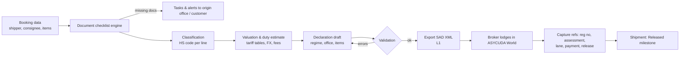

# 07 — Customs & ASYCUDA Integration

## 1. Goal

Make customs clearance at Iraqi entry points **predictable and fast**. Every shipment should arrive with complete, verified documents and a declaration ready to lodge (pre-arrival). The broker should never re-type data that already exists in Logistico.

## 2. Reality check (from [01 — Research](01-research-findings.md))

- Federal Iraq runs **ASYCUDA World** at all 22 federal crossings (Nov 2025). Electronic declarations have been mandatory since 1 Jan 2025, electronic manifests are linked with shipping agencies and airlines, and pre-arrival declarations started Dec 2025.
- **CoO and commercial invoice e-verification** has been mandatory since **10 Jul 2026**. Declarations without verified documents can be **suspended**.
- Duty **pre-payment** is automated through ASYCUDA and approved e-payment channels (Sep 2026). There is an e-payment portal on the **Ur** platform.
- **No public API** for private companies has been documented. ASYCUDA World supports **SAD XML import/export** and **manifest XML** submission.
- **Kurdistan Region** crossings are **not** on ASYCUDA (status contested).
- **COSQC Certificate of Conformity** is required for regulated goods (pre-shipment inspection). The Iraqi Quality Mark has been optional since March 2026.

## 3. Integration levels

We build up in levels. Each level is useful on its own.

| Level | What | Depends on | Phase |
|---|---|---|---|
| **L0 — Data capture** | Every customs reference, document and status is stored on the shipment: declaration numbers, assessment/receipt/release numbers, selectivity lane, CoO/invoice e-verification numbers, COC number, payment references. Broker dashboard. | Nothing external | ✅ **Built**: customs workbench (queue with lanes, offices, holds; declaration editor; e-verification numbers) |
| **L1 — XML generation** | Generate **SAD XML** (and manifest/degroupage XML for consolidations) from shipment data, validated against the ASYCUDA World schema used in Iraq. The broker imports it in the ASYCUDA World client ("Import XML File"). | Iraqi schema version + sample files from GCA or a licensed broker | 🟡 **First version built**: SAD XML export following UNCTAD's published message description. Must be validated against Iraq's schema with real broker files before use (Phase 3). |
| **L2 — Round-trip assist** | Import XML exported back from ASYCUDA (assessed declaration) to update Logistico automatically: assessed duties, lane, numbers. Watch-folder automation on the broker's PC through the LX Device Service (proposed). | L1 | Phase 3 |
| **L3 — Direct B2G link** | Web-service integration with GCA (submit, query status, receive release) if the GCA offers it to declarants or Authorized Economic Operators | Formal agreement with GCA / UNCTAD project | Phase 4+ (opportunistic) |

> **We will not screen-scrape or run robots against government systems.** That would be fragile and likely a breach of access terms. L3 happens only through an official channel.

## 4. Customs workbench (module features)



### 4.1 Document checklist engine

Rules decide which documents a shipment needs. Rules are **effective-dated** and keyed by HS chapter/heading, origin country, entry point, regime and party type.

| Document | Typical rule | Verification captured |
|---|---|---|
| Commercial invoice | Always | **e-verification number** (mandatory since 10 Jul 2026), verified-at |
| Certificate of Origin | Always for imports (and for preferential origin) | **e-verification number** |
| Packing list | Always | — |
| Bill of lading / AWB / CMR | By mode | Number, matched against manifest |
| COSQC Certificate of Conformity (COC) | Regulated HS codes, federal entry points | COC number, issuing body, validity |
| Import licence / permits | Specific HS codes (pharma, chemicals, telecom equipment, …) | Licence number, authority, expiry |
| Health/phytosanitary certificates | Food, plants, animals | Certificate number |
| Dangerous goods declaration | DG shipments | UN number, class |

A shipment cannot reach **"Ready to declare"** until its checklist is green. Missing items create tasks for the origin office or the customer, with WhatsApp reminders.

### 4.2 Classification

- Iraqi national tariff (HS-based) loaded as **reference data with effective dates**. Tariff changes are new versions, never overwrites.
- Per-customer **classification memory**: the same SKU gets the same HS code unless a broker overrides it, with a reason.
- Phase 4: **AI suggestions** from Arabic/English/Chinese descriptions. These are suggestions only; a broker confirms every code.

### 4.3 Valuation & duty estimation

- Customs value (CIF basis), FX at the rate customs uses (stored per declaration), duty rate per tariff line, other taxes and fees as configurable formula components.
- The output is an **estimate** for quotes and cash planning. The **assessed** amounts from ASYCUDA are the truth and are stored separately, so the estimate-vs-assessed variance becomes a KPI.

### 4.4 Declaration model

- Regimes (e.g., import for home use, warehousing, transit, temporary admission, export, re-export) are configurable codes.
- One shipment can have several declarations (e.g., transit, then home use). One consolidated master can feed one manifest with many house lines (degroupage).
- `system` field: `ASYCUDA_IQ` | `KRG_MANUAL` | `ORIGIN_EXPORT` | `OTHER`. Each system has an adapter implementing:

```csharp
public interface ICustomsSystemAdapter
{
    string SystemCode { get; }
    ValidationResult Validate(Declaration declaration);
    Task<GeneratedDocument> ExportAsync(Declaration declaration, CancellationToken ct); // SAD XML, PDF form, …
    Task<ImportResult> ImportResponseAsync(Stream file, CancellationToken ct);         // L2 round-trip
}
```

### 4.5 Kurdistan Region entry points

Until ASYCUDA reaches KRG crossings, the `KRG_MANUAL` adapter produces printable declaration data and checklists, and captures KRG reference numbers manually. When KRG adopts ASYCUDA, those entry points switch adapter in configuration, not code.

### 4.6 Origin-side export customs

Origin offices (China, Turkey, UAE, …) need export declarations in their country. Phase 1 captures export references and documents (L0). Country-specific export adapters (e.g., XML for a given export system) are added only where volumes justify them.

## 5. Compliance screening (built into the same module)

| Check | When | Action |
|---|---|---|
| **Restricted/denied party screening** (UN, US OFAC SDN, EU, UK consolidated lists) on shipper, consignee, notify party, payer | Booking + before release | Hold + compliance case; requires compliance officer approval |
| **Prohibited/restricted goods** by HS code and keywords (weapons, dual-use, drugs, sanctioned-origin goods) | Booking + classification | Block or require licence |
| **Dangerous goods** | Booking | Mode restrictions (IATA DGR / IMDG), DG documents |
| **Sanctioned routing** (transhipment via sanctioned jurisdictions, sanctioned vessels) | Booking + carrier assignment | Warn/hold |

Sanctions lists are refreshed daily by the Integrations module. Every screening result is stored with the list version used, for audit.

## 6. Engagement plan with the General Customs Authority (start in Phase 0)

1. Confirm the company's **broker/declarant status** (or the partner broker's) and ASYCUDA World credentials.
2. Request the **ASYCUDA World version** used in Iraq, the **SAD XML schema/message description** and **manifest XML** spec, and sample files.
3. Ask whether a **test/training environment** exists for declarants.
4. Ask about **web-service access** for declarants/AEOs (L3) and the AEO programme in Phase Two.
5. Ask how **CoO/invoice e-verification numbers** must be formatted in declarations, and whether the Federation of Iraqi Chambers of Commerce offers a verification API.
6. Ask about the **Ur platform** e-payment integration for duty pre-payment references.
7. Record every answer in this document. Requirements here will change.

## 7. Risks

| Risk | Mitigation |
|---|---|
| GCA does not share schemas / no test environment | Build from the published UNCTAD SAD XML description; validate with a licensed broker's real exports (anonymised) |
| Iraqi-specific fields differ from the generic SAD | Adapter + mapping tables are configuration, versioned |
| Rules change with little notice (e.g., e-verification, Quality Mark) | Effective-dated rule engine; a compliance owner updates rules without a deploy |
| KRG divergence | Pluggable adapter per entry point |
| Broker dependency | Workbench supports both in-house brokers and external partner brokers (partner portal access) |
