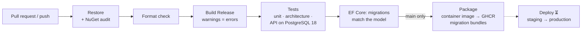

# 11 — CI/CD & DevOps

## 1. Repository & branching

- **Monorepo**, one solution: `Logistico.slnx` (the .NET 10 XML solution format).
- **Trunk-based development:** short-lived branches → pull request → `main`. `main` is always releasable.
- **Central Package Management** (`Directory.Packages.props`): one version per package for the whole solution, with transitive security pins.
- **Shared build settings** (`Directory.Build.props`): nullable on, warnings as errors, deterministic builds.
- **SDK pinned** in `global.json` (10.0.400, roll forward within the feature band). **Tools pinned** in `dotnet-tools.json` (`dotnet-ef`).
- **Formatting** enforced by `.editorconfig` + `dotnet format`.

Suggested branch protection on `main` (to configure in GitHub): require PR review, require the CI check "Build & test", require linear history, block force pushes.

## 2. Pipeline (implemented: `.github/workflows/ci.yml`)



| Stage | What it guarantees |
|---|---|
| Restore + NuGet audit | No package with a known vulnerability enters the build |
| Format check | Consistent code style; no style churn in reviews |
| Build (Release, warnings as errors) | Nullable and analyzer warnings are fixed, not ignored |
| Tests | Domain rules, module boundaries, and the real HTTP API against a real PostgreSQL service container |
| Migrations vs model | Nobody changes the EF model without adding a migration |
| Docker image (parallel job) | The `Dockerfile` behind `docker compose up` still builds, so people can try Logistico without the .NET SDK |
| Package (main) | Immutable container image tagged with the commit SHA; self-contained EF migration bundles as artifacts |

**Secrets used by CI:** only the built-in `GITHUB_TOKEN` (push to GitHub Container Registry). No third-party licence keys are needed: the UI uses open-source Blueprint assets committed in `wwwroot/lib`.

> Every step's command has been run locally (format, Release build, all tests on PostgreSQL, migration check, Docker
> image build and a browser smoke test of the container). Check the Actions tab after the first pushes for environment
> differences such as base-image pulls.

## 3. Tests

| Suite | Scope | Runs against | Count today |
|---|---|---|---|
| `Logistico.Modules.Shipments.Tests` | Tracking-number check digit, chargeable weight, state machines (incl. dead-end detection), shipment and COD rules, delivery promise, tracking stages, customs duties, Code-128, hub routing and misroutes, Iraqi phone numbers, Arabic/English number and date formats | Pure C# | 88 |
| `Logistico.ArchitectureTests` | Module boundaries (contracts free of server deps, client sees only contracts, single public entry point, modules talk only through contracts); every UI text exists in Arabic and English and every key used on a page exists | Reflection + resx | 12 |
| `Logistico.Web.IntegrationTests` | REST API end to end: 401s, booking, Instagram order through the warehouse to COD delivery, sellers, multi-hub scans and misroutes, customs e-verification gate and SAD XML, customs queue paging and filters, fleet couriers, COD settlements, ETag concurrency (428/412), 422 rule codes, 400 validation, Arabic error messages, list filters/paging/totals in SQL, CSV export, tenant isolation, public tracking | `WebApplicationFactory` + PostgreSQL (one throw-away database per test class) | 20 |
| Browser E2E (🟡) | Arabic journey: sign in → new seller order → warehouse receive → dispatch with courier → delivered with COD → public tracking page; plus a crawl of every page in both languages and at phone width checking console errors, failed requests and horizontal overflow (scripted and passing with headless Chrome; to be ported to Playwright for .NET in CI) | Chrome | — |
| Load (🟡) | k6 against grid and booking endpoints with 1 M seeded shipments | Staging | — |

## 4. Database migrations

- EF Core migrations live **per module** (`src/Logistico.Web/Data/Migrations` for Identity, `Modules/X/Infrastructure/Migrations` for each module), each with its own history table in its own schema.
- **Development:** the app migrates on start-up (`Database:MigrateOnStartup=true` in `appsettings.Development.json`).
- **Production:** never migrate from the app. The pipeline produces **three self-contained migration bundles** (`migrate-identity`, `migrate-merchants`, and `migrate-shipments`), and the deploy step runs all three **before** the new version starts (Kubernetes Job / Argo CD PreSync hook).
- Rules: expand → migrate → contract for breaking schema changes; `lock_timeout` in migration sessions; review the generated SQL (`dotnet ef migrations script --idempotent`) in every PR that adds a migration.

Production also requires a durable shared Data Protection key volume. Set `DataProtection__KeyRingPath` to its mounted path (for example `/var/lib/logistico/keys`) on every replica. The host fails fast when this is absent, preventing cookies from becoming invalid after a restart or when requests move between replicas.

For the first deployment only, set `Seed__AdminEmail` and `Seed__AdminPassword`. Bootstrap provisioning runs independently of in-process migrations, creates or repairs the administrator role assignment, and is safe to repeat. Remove the password secret after the account exists and rotate that initial password immediately.

The orchestrator should use `/health/live` for liveness and `/health/ready` for readiness. Readiness executes a bounded PostgreSQL query; neither endpoint requires authentication and both disable response caching.

Add a migration:

```bash
dotnet ef migrations add <Name> \
  --project src/Modules/Shipments/Logistico.Modules.Shipments \
  --startup-project src/Logistico.Web \
  --context ShipmentsDbContext --output-dir Infrastructure/Migrations
```

## 5. Releases & deployment (proposed, needs hosting decision)

- **Versioning:** SemVer from conventional commits (release-please); the image is tagged with the version and commit SHA.
- **Environments:** preview (per PR, optional) → dev → staging → production ([05](05-infrastructure-and-deployment.md) §6).
- **Promotion:** GitOps. A release PR bumps the image tag in the environment repo; Argo CD syncs staging automatically and production after approval; canary with Argo Rollouts.
- **Rollback:** redeploy the previous image tag. Migrations are backward-compatible by the expand/contract rule, so an app rollback never needs a schema rollback.
- **Simpler start (alternative):** a single VM with Docker Compose (app + PostgreSQL + backups) in an Iraqi data centre or UAE cloud, deployed by a GitHub Actions job over SSH. This is fine for the pilot; move to Kubernetes when scale or HA requires it.

## 6. Developer workflow

```bash
dotnet build Logistico.slnx                 # build everything
dotnet run --project src/Logistico.Web      # run (http://localhost:5210)
dotnet test tests/<suite>                   # run a test suite
dotnet format Logistico.slnx                # fix formatting before committing
```

Hot reload: `dotnet watch --project src/Logistico.Web` rebuilds the WebAssembly client and server on change.
