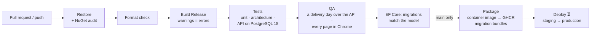

# 11 — CI/CD & DevOps

## 1. Repository & branching

- **Monorepo**, one solution: `Logistico.slnx` (the .NET 10 XML solution format).
- **Trunk-based development:** short-lived branches → pull request → `main`. `main` is always releasable.
- **Central Package Management** (`Directory.Packages.props`): one version per package for the whole solution, with transitive security pins.
- **Shared build settings** (`Directory.Build.props`): nullable on, warnings as errors, deterministic builds.
- **SDK pinned** in `global.json` (10.0.400, roll forward within the feature band). **Tools pinned** in `dotnet-tools.json` (`dotnet-ef`).
- **Formatting** enforced by `.editorconfig` + `dotnet format`.

Suggested branch protection on `main` (to configure in GitHub): require PR review, require the CI check "Build & test", require linear history, block force pushes.

## 2. Pipeline (implemented: `.github/workflows/ci.yml`)



| Stage | What it guarantees |
|---|---|
| Restore + NuGet audit | No package with a known vulnerability enters the build |
| Format check | Consistent code style; no style churn in reviews |
| Build (Release, warnings as errors) | Nullable and analyzer warnings are fixed, not ignored |
| Tests | Domain rules, module boundaries, and the real HTTP API against a real PostgreSQL service container |
| QA | The built server started as people run it, then used the way a company uses it: shops book, the hub receives and loads a truck, couriers deliver and fail, cash is handed in and sellers are paid; then every menu page is opened in Chrome by every office role, in Arabic and English and at phone width (§3) |
| Migrations vs model | Nobody changes the EF model without adding a migration |
| Docker image (parallel job) | The `Dockerfile` behind `docker compose up` still builds, so people can try Logistico without the .NET SDK |
| Package (main) | Immutable container image tagged with the commit SHA; self-contained EF migration bundles as artifacts |

**Secrets used by CI:** only the built-in `GITHUB_TOKEN` (push to GitHub Container Registry). No third-party licence keys are needed: the UI uses open-source Blueprint assets committed in `wwwroot/lib`.

> Every step's command has been run locally (format, Release build, all tests on PostgreSQL, migration check, Docker
> image build and a browser smoke test of the container). Check the Actions tab after the first pushes for environment
> differences such as base-image pulls.

## 3. Tests

| Suite | Scope | Runs against | Count today |
|---|---|---|---|
| `Logistico.Modules.Shipments.Tests` | Tracking-number check digit, chargeable weight, state machines (incl. dead-end detection), shipment and COD rules, delivery promise, tracking stages, customs duties, Code-128, hub routing and misroutes, Iraqi phone numbers (Arabic-Indic digits too), Arabic/English number and date formats, the paste-to-order reader | Pure C# | 277 |
| `Logistico.ArchitectureTests` | Module boundaries (contracts free of server deps, client sees only contracts, single public entry point, modules talk only through contracts); every UI text exists in Arabic and English and every key used on a page exists; every refusal code the API can send has a message in both languages | Reflection + resx | 34 |
| `Logistico.Web.Client.Tests` | The console's own logic and shared components rendered with bUnit: which pages and actions each role sees, menu and guide links, shortcuts, plurals and money in both languages, tables, pager, status tags, the getting-started card and installation health | bUnit | 46 |
| `Logistico.Web.IntegrationTests` | REST API end to end: 401s, booking, Instagram order through the warehouse to COD delivery, sellers, multi-hub scans, trucks and misroutes, simultaneous scans, customs e-verification gate and SAD XML, fleet couriers and the cash desk, COD settlements, ETag concurrency (428/412), 422 rule codes, 400 validation, Arabic error messages, list filters/paging/totals in SQL, CSV export, tenant isolation, public tracking, first run, roles | `WebApplicationFactory` + PostgreSQL (one throw-away database per test class) | 162 |
| `Logistico.Qa` (category `Qa`) | **A delivery day**: three shops, three couriers and a hub working at once through the API (simultaneous receive scans, one truck to Basra, delivered, refused and no-answer attempts, re-dispatch, public tracking, a rating, cash hand-in, payouts, a double payout refused); every parcel and every dinar must be accounted for and no call may fail with 5xx. Writes `TestResults/qa/delivery-day.md` with the time of every endpoint (p50/p95). **Every page**: every menu page opened in Chrome by admin, operations, support, finance and viewer, in Arabic and English and at 390 px, failing on script errors, refused or failed API calls, untranslated text keys and sideways scrolling | The built server in its own process on a free port with its own database; Playwright for .NET with the installed Chrome | 9 |
| Load (🟡) | k6 against grid and booking endpoints with 1 M seeded shipments | Staging | — |

Run them:

```bash
dotnet test Logistico.slnx --filter "Category!=Qa"      # everything but the QA suite (about a minute)
dotnet build Logistico.slnx -c Release && dotnet test tests/Logistico.Qa -c Release --no-build   # the QA suite (about two minutes)
LOGISTICO_QA_URL=http://127.0.0.1:5311/ dotnet test tests/Logistico.Qa --filter "FullyQualifiedName~EveryPage"   # against a server you started
```

The QA suite needs PostgreSQL (`LOGISTICO_TEST_DB`, as the integration tests) and Google Chrome. It drops its database
when it finishes; the server's log is kept in `TestResults/qa/server.log`.

## 4. Database migrations

- EF Core migrations live **per module** (`src/Logistico.Web/Data/Migrations` for Identity, `Modules/X/Infrastructure/Migrations` for each module), each with its own history table in its own schema.
- **Development:** the app migrates on start-up (`Database:MigrateOnStartup=true` in `appsettings.Development.json`).
- **Production:** never migrate from the app. The pipeline produces **four self-contained migration bundles** (`migrate-audit`, `migrate-identity`, `migrate-merchants`, and `migrate-shipments`), and the deploy step runs all four, `migrate-audit` first, **before** the new version starts (Kubernetes Job / Argo CD PreSync hook).
- Rules: expand → migrate → contract for breaking schema changes; `lock_timeout` in migration sessions; review the generated SQL (`dotnet ef migrations script --idempotent`) in every PR that adds a migration.

Production also requires a durable shared Data Protection key volume. Set `DataProtection__KeyRingPath` to its mounted path (for example `/var/lib/logistico/keys`) on every replica. The host fails fast when this is absent, preventing cookies from becoming invalid after a restart or when requests move between replicas.

For the first deployment only, set `Seed__AdminEmail` and `Seed__AdminPassword`. Bootstrap provisioning runs independently of in-process migrations, creates or repairs the administrator role assignment, and is safe to repeat. Remove the password secret after the account exists and rotate that initial password immediately.

The orchestrator should use `/health/live` for liveness and `/health/ready` for readiness. Readiness executes a bounded PostgreSQL query; neither endpoint requires authentication and both disable response caching.

Add a migration:

```bash
dotnet ef migrations add <Name> \
  --project src/Modules/Shipments/Logistico.Modules.Shipments \
  --startup-project src/Logistico.Web \
  --context ShipmentsDbContext --output-dir Infrastructure/Migrations
```

## 5. Releases & deployment (proposed, needs hosting decision)

- **Versioning:** SemVer from conventional commits (release-please); the image is tagged with the version and commit SHA.
- **Environments:** preview (per PR, optional) → dev → staging → production ([05](05-infrastructure-and-deployment.md) §6).
- **Promotion:** GitOps. A release PR bumps the image tag in the environment repo; Argo CD syncs staging automatically and production after approval; canary with Argo Rollouts.
- **Rollback:** redeploy the previous image tag. Migrations are backward-compatible by the expand/contract rule, so an app rollback never needs a schema rollback.
- **Simpler start (alternative):** a single VM with Docker Compose (app + PostgreSQL + backups) in an Iraqi data centre or UAE cloud, deployed by a GitHub Actions job over SSH. This is fine for the pilot; move to Kubernetes when scale or HA requires it.

## 6. Developer workflow

```bash
dotnet build Logistico.slnx                 # build everything
dotnet run --project src/Logistico.Web      # run (http://localhost:5210)
dotnet test tests/<suite>                   # run a test suite
dotnet format Logistico.slnx                # fix formatting before committing
```

Hot reload: `dotnet watch --project src/Logistico.Web` rebuilds the WebAssembly client and server on change.

## 7. Jenkins (implemented: `Jenkinsfile`, `deploy/jenkins/`, `scripts/jenkins.sh`)

A Jenkins on a developer's or the office's own machine runs the same checks as GitHub Actions, plus the package step,
for every branch of the repository. Everything about it is in the repository: the pipeline (`Jenkinsfile`), the
server's settings as code (`deploy/jenkins/jenkins.yaml`, Configuration as Code) and its plugins
(`deploy/jenkins/plugins.txt`). Nothing is configured by clicking, so a broken Jenkins is rebuilt by starting it again.

```bash
brew install jenkins-lts openjdk@21      # once
scripts/jenkins.sh setup                 # once: plugins, and an administrator password in ~/.logistico-jenkins
scripts/jenkins.sh start                 # http://127.0.0.1:8090/  (user admin)
scripts/jenkins.sh password              # prints the administrator password
scripts/jenkins.sh status | logs | stop
```

| Stage | What runs |
|---|---|
| Tools, Restore, Format, Build | As in GitHub Actions: NuGet audit, `dotnet format --verify-no-changes`, Release build with warnings as errors |
| Checks (in parallel) | Tests with coverage (fails below 85 %), migrations match the model, the Flutter app (texts, analyze, tests) |
| QA | `tests/Logistico.Qa` as in §3 |
| Docker image | Only on a machine with Docker |
| Package | On `main`, or when the build is started with *PACKAGE*: the published server as a tarball and the four migration bundles, kept with the build |

Test results (JUnit) and coverage show on each build's page; the QA reports and the server log are kept as artifacts.

**Security.** Jenkins listens on `127.0.0.1` only. Nobody can read it without signing in, and sign-up is closed. It
builds the branches of `Haix02/logistico-software` only and never pull requests from forks, because a build runs the
code it builds on this machine. The test database's connection string is a Jenkins credential
(`logistico-test-db`), taken from `LOGISTICO_TEST_DB` at start-up; the administrator password is generated by `setup`
and kept outside the repository. Branches are scanned every five minutes; *Scan Multibranch Pipeline Now* scans at once.
