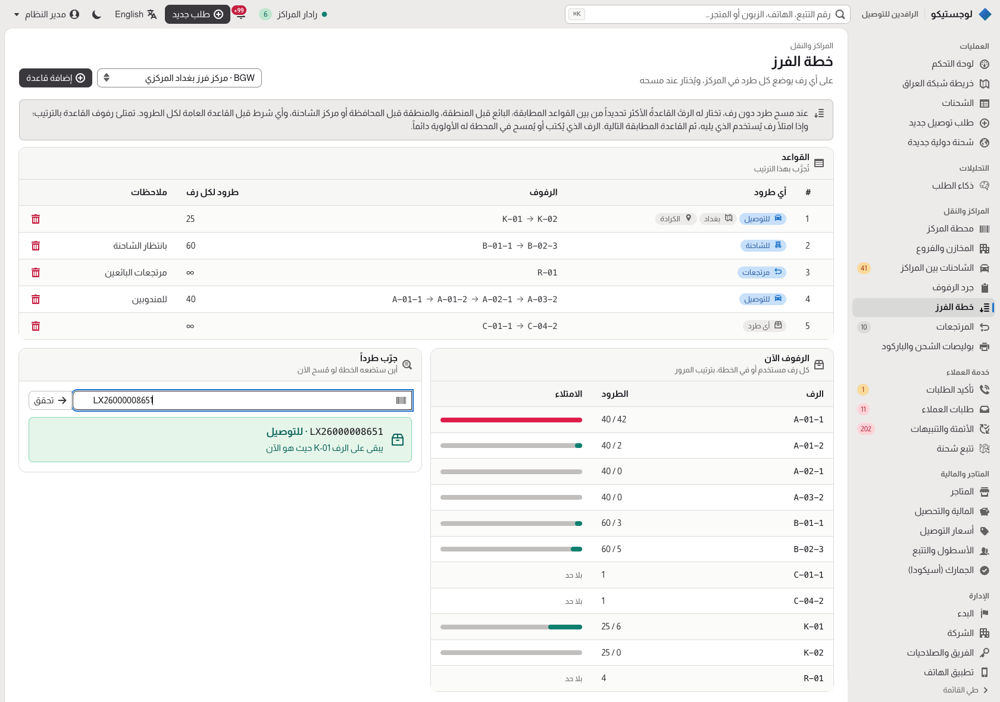

# 18 — Ideas from open-source logistics projects

What comparable open-source projects do well, what Logistico takes from them, and what still needs a decision. Reviewed
in October 2026. We take ideas and behaviour, not code: the projects below use other languages and licences.

| Project | Licence | What it is good at | What we take |
|---|---|---|---|
| [Fleetbase](https://github.com/fleetbase/fleetbase) (Fleet-Ops, Navigator app) | AGPL-3.0 | Delivery operations: order flows with custom steps, a driver app, proof of delivery (signature, timestamp, photo, QR), comments and files on orders, service areas and rates | Proof of delivery in the courier app; internal comments on orders |
| [OpenBoxes](https://openboxes.com) | EPL | Inventory with an audit trail on every stock movement; cycle counts (schedule, count, reconcile) since 0.9.4 | Shelf checks at the hubs: count what is on a shelf and reconcile it with the system |
| [Karrio](https://github.com/karrioapi/karrio) | Apache-2.0 (core) | Multi-carrier shipping API: rates, labels, normalised tracking, webhooks on shipping milestones, documents | Webhooks for sellers' own systems (needs a decision, below) |
| [VROOM](https://github.com/VROOM-Project/vroom) + [OSRM](https://github.com/Project-OSRM/osrm-backend) | BSD-2 / BSD-2 | Route optimisation: time windows, capacities, pickups and deliveries, on OpenStreetMap roads | Planned courier runs (needs a decision, below) |
| [Traccar](https://github.com/traccar/traccar) | Apache-2.0 | GPS tracking server: devices, geofences, trips | Already proposed for live fleet tracking ([13](13-roadmap.md)) |
| ERPNext Delivery Trip | GPL-3.0 | A trip with ordered stops and a driver | Our courier run sheet already covers it; optimisation is the gap (VROOM) |
| [Odoo Inventory](https://www.odoo.com/documentation/15.0/applications/inventory_and_mrp/inventory/routes/strategies/putaway.html) (Community) | LGPL-3.0 | Putaway rules (where received goods go, by product or category), [storage categories](https://www.odoo.com/documentation/15.0/applications/inventory_and_mrp/inventory/routes/strategies/storage_category.html) with capacity, [wave picking](https://www.odoo.com/documentation/19.0/applications/inventory_and_mrp/inventory/shipping_receiving/picking_methods/wave.html) | Hub sort plans with capacity and overflow (below) |
| Parcel sort plans ([Georgia Tech, sort plan design](https://www2.isye.gatech.edu/~atoriello3/Sort_plan_design_v2.pdf)) | Research | Assigning destinations to sort positions so each position fills evenly and loads in route order | Shelves per area, truck lane and returns, filled in order |

## Built from these ideas

- **Proof of delivery** (Fleetbase): when a courier marks a parcel delivered, the app records who received it (the
  customer or someone for them, with a name), an optional finger signature, and where the phone was. Failed attempts
  record the place too, so "the courier never came" can be checked. The office sees all of it on the order.
- **Shelf checks** (OpenBoxes cycle counts): at the hub station, scan everything on a shelf (or the whole hub); the
  check lists parcels that should be there but were not scanned, parcels scanned that the system places elsewhere, and
  parcels on the wrong shelf, and fixes the shelf in one step. Each check is kept with who did it.
- **Comments on orders** (Fleetbase): staff leave notes on an order for each other (call desk, hub, finance), with who
  and when, instead of overwriting one notes field.

- **Hub sort plans** (Odoo putaway rules and storage categories; parcel sort plans): each hub lists which parcels go on
  which shelves — for its couriers by governorate or area, waiting for the truck to a given hub, returns for the
  seller, one big seller's own shelf — with how many parcels fit on each. A receive scan without a shelf follows the
  plan. As in Odoo, the most specific matching rule wins and full places are skipped. For parcels the conditions are
  what a parcel waits for, where it goes and whose it is; a rule lists several shelves that fill in order; when every
  shelf a parcel may use is full it still gets the emptiest one and the scan says so, instead of none; and the station
  shows the chosen shelf large, so it can be read with the parcel in hand. The plan page shows every shelf in walking
  order (A-2 before A-10) with its load, and answers "where would this parcel go?" without scanning it.
  
- **Orderly lists**: shelves sort the way people walk a hub everywhere (a natural, numeric collation in PostgreSQL),
  statuses sort by the order a parcel lives through them, and every sort has a tiebreaker so a page never repeats or
  skips an order.

## Needs a decision first

These add a server, a provider or a storage service, so they wait for the maintainers ([14](14-architecture-decisions.md)):

1. **Route optimisation** — VROOM with OSRM on Iraq's OpenStreetMap data (two self-hosted services), or a paid API.
   Addresses would also need map positions (customers rarely give them; landmarks are text).
2. **Photo proof of delivery** — photos need file storage (S3-compatible such as MinIO, or the database for small
   images) and a retention rule.
3. **Delivery codes by SMS or WhatsApp** — a one-time code the customer tells the courier; reliable only with automatic
   sending through a provider (WhatsApp Business API or an Iraqi SMS gateway), since staff send messages by hand today.
4. **Webhooks for sellers** (Karrio) — signed HTTP callbacks to a seller's shop system on each milestone, with retries.
   Useful once sellers with their own systems ask for it.
5. **Live GPS** (Traccar) — devices or the courier app sending positions while on duty.
