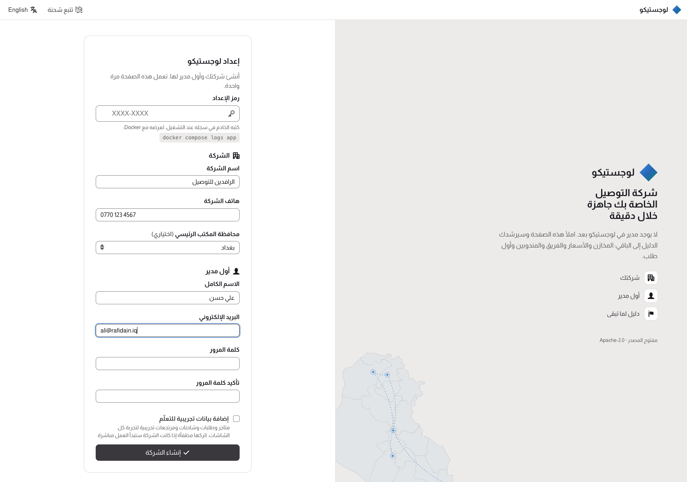
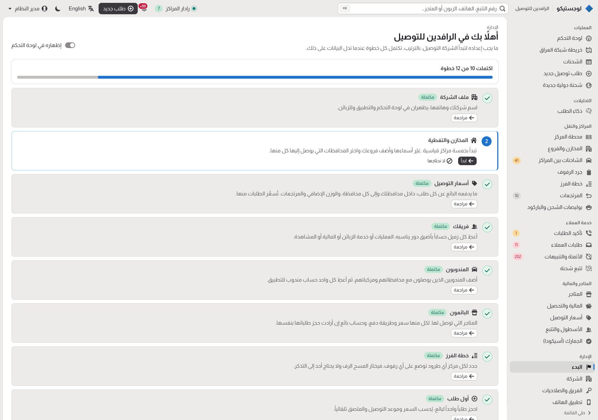
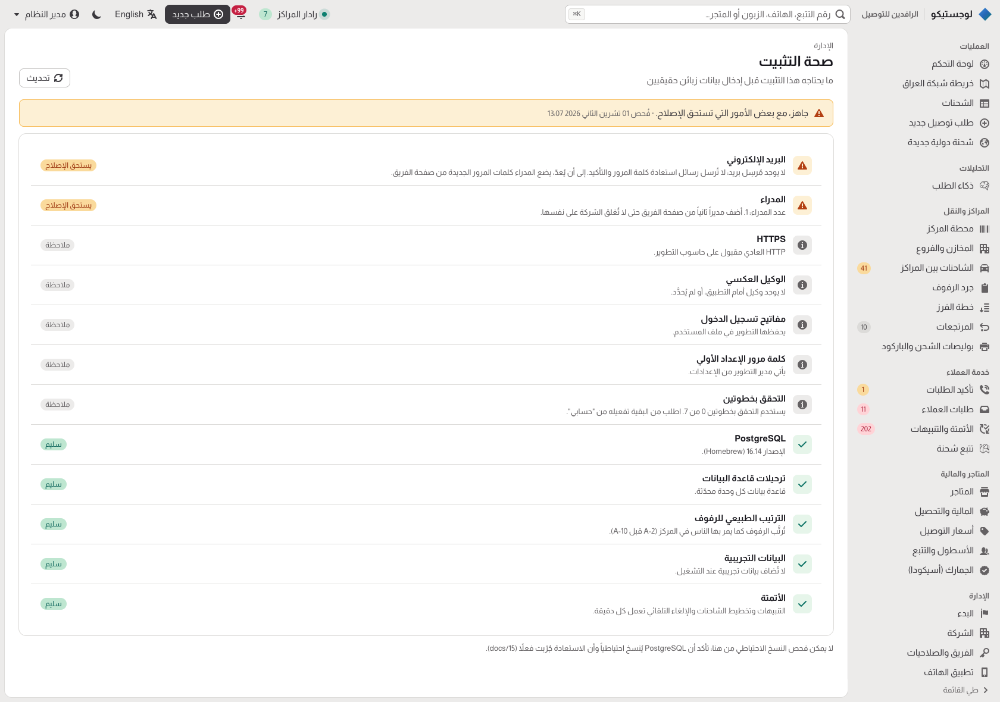

# 19 — First run and getting started

How a new installation of Logistico becomes a working company: the setup page that creates the first administrator,
the company profile, the getting-started guide that walks each role through what to set up, and the installation
health page. Designed in November 2026 after reading how comparable open-source projects do it (§6).

## 1. The first run

Until an installation has an administrator, every page leads to **`/setup`** (`/Account/Setup`).

1. **Setup code.** When the app starts without an active administrator it writes a one-time code to its log:

   ```text
   Logistico has no administrator yet. Open /setup and enter the setup code K7QF-M2XD
   ```

   With Docker: `docker compose logs app`. The code changes at every start; set `Setup:Code` to choose it instead
   (automation, several instances). Whoever can read the server's log can set it up; someone who only reaches the web
   page cannot. Wrong codes are rate-limited per address.
2. **One form**, in Arabic or English (switch at the top):
   - the company: name, phone, and (optionally) the head office governorate;
   - the first administrator: name, email, password (Identity's password rules);
   - "Add sample data to learn with" (off by default): sample shops, orders, trucks and returns, clearly marked as
     samples, for evaluation and training.
3. **Done once.** The form creates the administrator and the company profile in one transaction under a PostgreSQL
   advisory lock, after checking again that no administrator exists, so two people submitting at the same moment get
   one administrator. The new administrator is signed in and lands on **Getting started**. From then on `/setup`
   says the installation is set up and links to sign-in.
4. **Recovery.** If every administrator account is deactivated, restart the app: it finds no administrator, writes a
   new code to the log and opens the setup page again. That is the way back in for whoever runs the server; a person
   who only reaches the web page cannot use it. (A temporary lock-out after wrong passwords does not count.)



Unattended installations (CI, the evaluation Docker stack) can still create the first administrator from
`Seed:AdminEmail` / `Seed:AdminPassword`; the setup page is then closed.

## 2. Company profile

Administration → **Company**: the company's name, phone, head office governorate and address. The name appears in the
console's top bar next to Logistico. Stored per company in `iam.company_profiles`, which also keeps the getting-started
steps the company skipped.

## 3. Getting started

A guide on its own page and as a card on the dashboard until it is finished or hidden. Each step says why it matters,
links to the page that does it, and is done when the data says so, not when someone ticks a box:

| Step | Who | Done when |
|---|---|---|
| Company profile | Admin | the profile has a name and phone |
| Warehouses and coverage | Admin | a person added or changed a warehouse |
| Delivery prices | Admin, Finance | the price list was saved |
| Your team | Admin | at least two active accounts |
| Couriers | Operations | a courier exists |
| Sellers | Operations, Customer support | a seller exists |
| Sort plan | Operations | a hub has a sort plan rule |
| First order | Operations, Customer support | an order exists |
| First scan at a hub | Operations | a hub scan exists |
| Automation rules | Admin | the rules were saved |
| Mobile app | Admin | the app settings were saved |
| Installation health | Admin | no check fails |



Each person sees the steps their role can do (administrators see all). Operations and administrators can mark a step
"not for us" and bring it back (kept per company). Each person can hide the dashboard card and show it again from the
**Getting started** page (kept in their browser).

## 4. Installation health

Administration → **Installation health** checks what [15 — Production readiness](15-production-readiness.md) asks for
and says what to do when something is off:

- database reachable, PostgreSQL version, no pending migrations, the `natural` collation present (ICU);
- HTTPS, and `ReverseProxy:KnownNetworks` when requests arrive through a proxy;
- `DataProtection:KeyRingPath` set outside Development;
- a real email sender (the no-op sender cannot send password resets);
- the bootstrap `Seed:AdminPassword` setting removed after setup, and no demo seeding outside Development;
- at least two administrators, and how many staff use two-step sign-in;
- the automation sweep enabled.



## 5. Tests

- The setup page end to end: sign-in leads to setup, a wrong code and a refused password create nothing, the right
  code creates the administrator and the profile and signs in, and afterwards the page is closed; two simultaneous
  setups create one administrator.
- The guide follows the data (courier, seller, order, scan), skips and their permissions, each role's steps; the
  company profile's validation and concurrency; the health checks and who may read them.
- Every read endpoint of the API is called as every role on the demo company and must never answer with a server error.
- The console (bUnit): the getting-started card, the health page, role-gated actions, tables, the pager, mixed
  Arabic/Latin text, status tags; every menu entry and guide step leads to a page; every step and health answer has
  its text in both languages.

## 6. What we learned from other projects

Read in their source code in November 2026:

| Project | How it starts | What we do differently |
|---|---|---|
| [Fleetbase](https://github.com/fleetbase/core-api/blob/main/src/Http/Controllers/Internal/v1/OnboardController.php) | An install page with live progress when the database is not configured, then a sign-up form; `should-onboard` is true while no company exists and the first account becomes the administrator | Whoever reaches a fresh server first owns it there, and two first sign-ups at once can both become administrators. Here a code from the server log is required, and the setup runs once under a lock |
| [Frappe / ERPNext](https://github.com/frappe/frappe/blob/develop/frappe/desk/page/setup_wizard/setup_wizard.py) | A setup wizard (language, region, user, organisation) guarded by a lock so it runs once; onboarding modules with steps (create a record, open a page, watch a video) | Their onboarding steps are flags that can disagree with the data (marked done, then deleted). Here steps are worked out from the data every time |
| [Karrio](https://github.com/karrioapi/karrio/blob/main/docker/api/entrypoint) | The container creates a superuser from `ADMIN_EMAIL` / `ADMIN_PASSWORD`, defaulting to `admin@example.com` / `demo`, with a default secret key | No default password or secret: without settings, the setup page asks for them |
| [Traccar](https://github.com/traccar/traccar/blob/master/src/main/java/org/traccar/api/resource/UserResource.java) | The first account registered becomes the administrator | As for Fleetbase |
