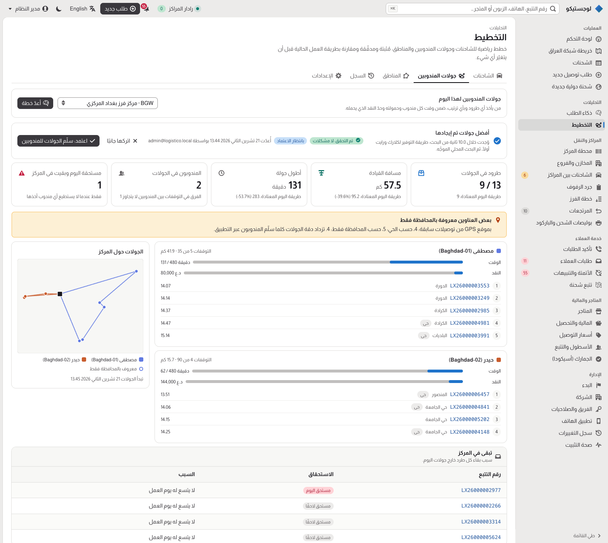
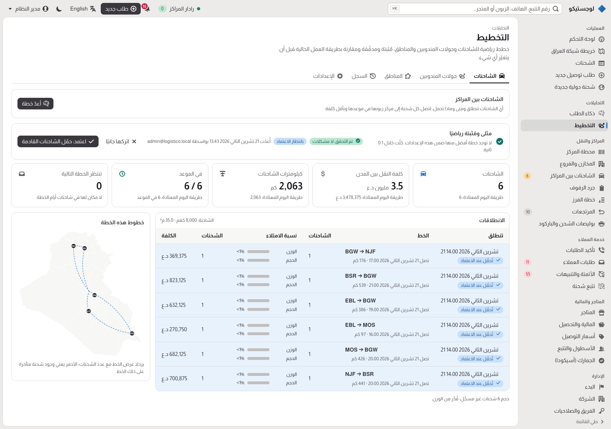
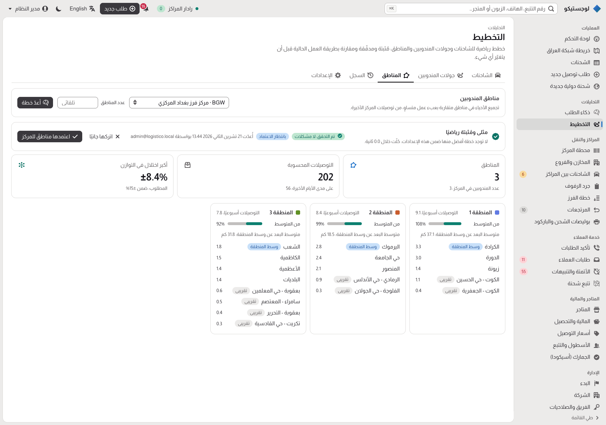

# 20 — Optimization engine (proposal)

> Status: **built** (2026-11-21): all three planners, the checker, the Planning screen and the API (`/api/v1/planning`).
> Decided: Google OR-Tools behind our own solver interface, and great-circle road estimates for now (OSRM later, §9).
> Still open: trucks changing at a third hub (the engine supports it; truck manifests take parcels for their own
> destination only, so it is off), customer pins on the tracking page (§4.3), and the hub-location what-ifs (§3.4).

Logistico should plan trucks, courier runs and zones with **operations research**: mathematical models solved by
exact or proven heuristic algorithms, not with AI guesses. Every plan is checked by a validator that does not trust
the solver, says how close it is to the best possible plan, and is applied only after a person approves it. When it
is applied, it goes through the same domain methods as today (`HubTransfer.Plan/Load`, `Shipment.DispatchToCourier`),
so the state machine, audit log and truck manifests stay correct.



## 1. What "best" means

Objectives are **lexicographic**, in this order. A plan never buys a lower cost by breaking a promise it could have kept.

1. **Service**: as few parcels as possible miss their promise (`EtaAt` / `RescheduledTo`). Lateness is weighted by hours
   late and by COD value at risk.
2. **Cost**: truck departures, kilometres and courier hours, priced from company settings (IQD per truck, per km,
   per hour).
3. **Balance**: even workloads across couriers and trucks (no 40-stop courier next to a 10-stop one).

The company sets the weights in **Automation → Planning**, behind `administer`. The defaults are documented and tested.

## 2. What data exists today

| Need | Available now | Gap |
|---|---|---|
| Hub positions, lanes | `HubInfo.Latitude/Longitude`, `HubNetwork.TransitHours` (great-circle × 1.2 road factor, 80 km/h) | Real road times (§9.2) |
| Parcel size | `GrossWeightKg`, `VolumeCbm`, `ChargeableWeightKg`, `Pieces` | Box dimensions (only needed for 3-D packing) |
| Deadlines | `PromisedAt`, `EtaAt`, `RescheduledTo`, Friday rule in `DeliveryPromise` | — |
| Cash risk | `CodAmount` per parcel | A company limit on cash a courier carries |
| Couriers | `VehicleType`, `Governorate`, active flag | Capacity per vehicle type, shift length |
| **Stop positions** | Governorate centroid (`IraqGovernorates`), delivery-proof GPS of past deliveries | **Coordinates per address**: the main gap for last-mile routing (§4.3) |

That is why the work is phased (§7): line-haul planning can be exact today, while last-mile routing first needs coordinates.

## 3. The models

### 3.1 Line-haul plan (daily): capacitated service network design

Which trucks run on which lanes, when they leave, and which parcels go on each. This is the consolidation problem of
LTL and express carriers ([Crainic 2024](https://cirrelt.ca/documentstravail/cirrelt-2024-12.pdf);
[Bakir, Erera & Savelsbergh 2021](https://econpapers.repec.org/RePEc:spr:sprchp:978-3-030-64018-7_12)).

- **Commodities** $k$: parcels grouped by (current hub, target hub, due time), with weight $w_k$, volume $v_k$, due $D_k$.
- **Arcs** $a=(i,j,t)$: a departure from hub $i$ to hub $j$ in time slot $t$, on a time-expanded network
  (direct lanes and lanes through a third hub).
- **Variables**: $y_a \in \mathbb{Z}_{\ge 0}$ trucks on arc $a$; $x^k_a \in [0,1]$ share of commodity $k$ on $a$;
  $\ell_k \ge 0$ hours late.

$$
\min\; M \sum_k p_k \ell_k \;+\; \sum_a f_a y_a \;+\; \sum_a \sum_k c_a w_k x^k_a
$$

subject to flow conservation for each $k$ on the time-expanded network; capacity
$\sum_k w_k x^k_a \le Q^w y_a$ and $\sum_k v_k x^k_a \le Q^v y_a$; arrival time minus $D_k \le \ell_k$; and a
truck-fleet limit per hub. With Iraq's 5–20 hubs and day slots this mixed-integer program is small enough to solve to
**proven optimality** in seconds. Its LP relaxation gives a lower bound, so the screen can say "optimal" or "within
0.8 % of optimal".

**Loading** inside each truck is a two-dimensional vector bin-packing (weight, volume). It is already covered by the
capacity rows. Exact three-dimensional packing ([Martello, Pisinger & Vigo 2000](https://econpapers.repec.org/RePEc:inm:oropre:v:48:y:2000:i:2:p:256-267))
is optional, for later, once parcels carry dimensions.

### 3.2 Courier runs (each morning, per hub): rich vehicle routing

A capacitated VRP with time windows and a heterogeneous fleet ([Toth & Vigo 2014](https://search.worldcat.org/title/Vehicle-routing-:-problems-methods-and-applications/oclc/896212133);
[Solomon 1987](https://econpapers.repec.org/RePEc:inm:oropre:v:35:y:1987:i:2:p:254-265)), with three constraints
specific to Iraq:

- **Cash carried**: the running sum of COD collected on a route stays $\le$ the company's cash limit per courier.
  It is a resource constraint like capacity, and an unusual one: it keeps couriers safe.
- **Optional stops**: when there are more stops than couriers can serve, this is the *prize-collecting* variant.
  The stops left for tomorrow are those whose delay costs least (not yet promised, low COD, already rescheduled).
- **Friday and agreed dates**: `RescheduledTo` is a hard time window, and Fridays are closed.

Algorithms, from the research:

1. **Construction**: Clarke–Wright savings $s_{ij} = d_{0i} + d_{0j} - d_{ij}$
   ([Clarke & Wright 1964](https://econpapers.repec.org/RePEc:inm:oropre:v:12:y:1964:i:4:p:568-581)) and the Solomon
   I1 insertion heuristic. They are fast, easy to explain, and serve as the baseline the improvement is measured against.
2. **Improvement**: local search with relocate, swap, 2-opt*, Or-opt and SWAP*, inside one of these:
   - **Hybrid Genetic Search**: state of the art for CVRP; open source, MIT
     ([Vidal 2022](https://arxiv.org/abs/2012.10384), [code](https://github.com/vidalt/HGS-CVRP)); PyVRP extends it
     to time windows ([Wouda et al. 2024](https://arxiv.org/html/2403.13795v2)).
   - **Adaptive Large Neighbourhood Search**: robust under many side constraints
     ([Ropke & Pisinger 2006](https://econpapers.repec.org/RePEc:inm:ortrsc:v:40:y:2006:i:4:p:455-472)).
   - Or the **OR-Tools** routing library with guided local search ([VRPTW guide](https://developers.google.com/optimization/routing/vrptw)).

Accuracy is measured, not claimed: CI runs the solver on the public **Solomon 100-customer** instances and checks the
gap to the best-known solutions ([SINTEF tables](https://www.sintef.no/projectweb/top/vrptw/solomon-benchmark/)) within a time limit.

### 3.3 Courier zones (monthly): balanced districting

Areas are grouped into one zone per courier, so that zones are compact, connected and **balanced within ±15 %** of
the average workload, the tolerance usual in logistics ([Kalcsics & Ríos-Mercado 2019](https://ideas.repec.org/h/spr/isochp/978-3-030-34312-5_4.html)).
Workload is the expected stops plus travel time, from the last 8 weeks. Model: a capacitated $p$-median, solved with a
location–allocation heuristic and local search, with an LP bound.

### 3.4 Network strategy (quarterly): hub location and coverage

What-if questions, such as "open a Najaf hub?" or "should Basra cover Maysan?", use a capacitated facility location
model on historical volumes. The two-echelon structure (line-haul to the city hub, then couriers) follows
[Cuda, Guastaroba & Speranza 2015](https://portal.mardi4nfdi.de/wiki/Publication:337424). The output is
advice, never applied automatically.

## 4. Architecture

```
src/Modules/Optimization/
  Logistico.Optimization.Core/        pure C#: models, objective, FEASIBILITY CHECKER, bounds, construction heuristics,
                                      ISolver<TProblem,TSolution>, seeded RNG. No EF Core, no ASP.NET, no I/O.
  Logistico.Optimization.<Solver>/    adapter for the chosen solver (§9.1), behind ISolver.
  Logistico.Optimization.Contracts/   DTOs and pure rules shared with the browser (plan views, settings, validation).
src/Modules/Shipments/.../Application/
  PlanBuilder        live data → problem instance (snapshot hash stored for reproducibility)
  PlanDesk           approved plan → existing domain methods, in one transaction, with If-Match on every truck/parcel
  PlanningWorker     background runs with time limits, progress and cancellation (same pattern as AutomationWorker)
```

- **Trust but verify**: the checker in Core recomputes every constraint and the objective for any solution, from any
  solver, before it is shown. A solver bug can never reach the dock.
- **Reproducible**: each `OptimizationRun` row stores inputs hash, parameters, solver and version, seed, time limit,
  objective, bound, gap, KPIs and the solution. The same inputs and seed always give the same plan.
- **Plans are proposals**: nothing moves until a person with `operate` approves it. Parcels that changed since the run
  are re-checked and either dropped from the plan or refused, with the reason (optimistic concurrency, as today).
- **Module boundaries** follow the house rules: architecture tests keep Core free of infrastructure, and Contracts free of EF/ASP.NET.

### 4.3 Coordinates for last-mile routing

Iraqi addresses are landmarks, not house numbers. Coordinates come from three sources, best first:

1. The customer drops a pin on the tracking page, after explicit consent (phone check as for requests).
2. The delivery-proof GPS of an earlier delivery to the same phone and address.
3. A fallback centroid of the area or city.

Each stop records which source it came from, and the plan shows its confidence.

## 5. How accuracy is proven

| Check | Where |
|---|---|
| Independent feasibility and objective recomputation for every solution | Core, every run |
| Proven optimum or lower bound and gap (line-haul LP/MIP; districting LP) | Run record, shown on screen |
| Benchmark gap on Solomon / CVRPLIB instances within a time limit | CI (`Category=Benchmark`) |
| Property tests: never over capacity or cash limit, every parcel planned once, Friday never used | Core tests |
| Golden instances from real (anonymised) Logistico days, objective must not regress | CI |
| Determinism: same seed, same plan | Core tests |

## 6. Screens (Blueprint, Arabic first, light and dark, 390 px)

**Planning** is a new navigation entry, with `operate` to approve and `administer` for settings. It has four tabs:

- **Trucks**: the Iraq map (`IraqMap` lanes) with the proposed trucks, line width showing volume, and a
  weight-and-volume fill bar per truck. Departure times and parcels at risk are listed. KPI cards show trucks, km,
  cost and on-time %, each against today's manual plan (`MetricDelta`). A *Why?* drawer per truck names the binding
  constraint ("full by volume", "leaves at 14:00 to keep 23 promises"). **Approve** opens or updates the loading trucks.
- **Courier runs**: per hub, one row per courier on a timeline, with stops in order, ETA windows, a cash-carried
  gauge and a stop map. Moving a stop re-checks the run at once with the checker. **Approve** hands the parcels out.
- **Zones**: a choropleth (`IraqChoropleth`) of zones with their workload balance.
- **Runs**: history with objective, bound, gap, solver, time and who approved.

| Trucks between hubs | Courier zones |
|---|---|
|  |  |

Everything visible is a resx key in both languages. Numbers and times are left-to-right inside Arabic text (`<Mixed>`).

## 7. Phases

1. **Line-haul planner** (data ready): model 3.1, checker, bound, Trucks tab, approve → `TransferPlanner`.
   Biggest saving per effort: fewer half-empty trucks and fewer missed promises between cities.
2. **Courier runs**: coordinate capture (§4.3), distance matrix, model 3.2, Courier runs tab.
3. **Zones and network what-ifs**: models 3.3 and 3.4.

## 8. Risks

- Inputs that are wrong produce plans that look sure of themselves. The plan therefore shows its data confidence
  (coordinate source, estimated vs road times) next to each number.
- Native solver binaries make the Docker image larger and need a runtime for every target (linux-x64/arm64, osx, win).
- People must keep the last word: every plan can be edited and is re-checked, and nothing is applied automatically
  in phase 1.

## 9. Decisions needed

1. **Solver**: (a) Google OR-Tools (Apache-2.0, [NuGet](https://www.nuget.org/packages/Google.OrTools)): MIP/CP-SAT,
   LP bounds and a routing library in one dependency, with native runtimes; (b) our own C# implementation of the
   published algorithms (HGS/ALNS, savings, LP via a small solver): no native code, but much more to build and prove;
   (c) a hybrid of the two.
2. **Road times**: the great-circle × 1.2 estimate in use today, or a self-hosted [OSRM](https://project-osrm.org/docs/v5.23.0/api)
   on the Iraq OpenStreetMap extract (a new service to run).
3. **Customer pins** on the tracking page: privacy wording and retention.
