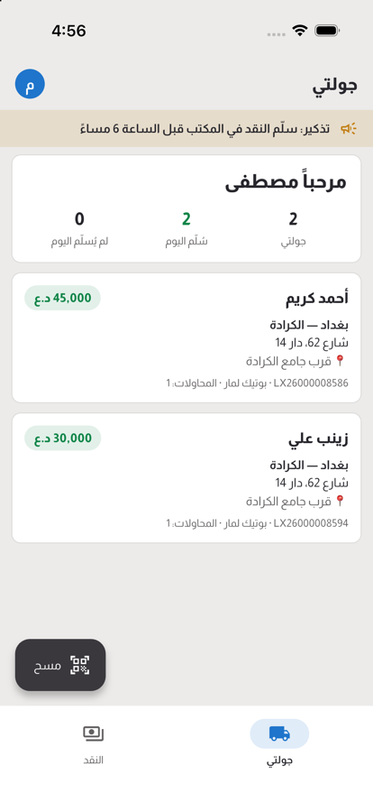
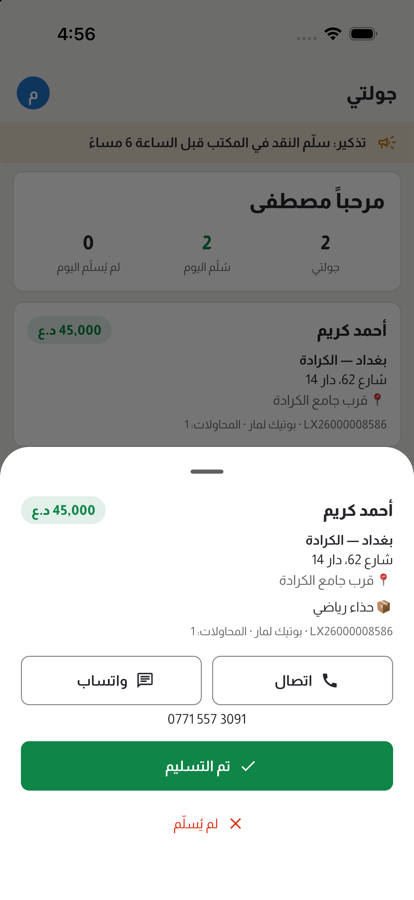

# Logistico mobile app

One Flutter app for Android and iOS whose screens follow the account that signs in, and whose content the company
controls from the web console (**Administration → Mobile app**). Design and decisions: [docs/09](../docs/09-client-applications.md),
[ADR-031](../docs/14-architecture-decisions.md).

<p>


</p>

| Account | Tabs (each one switchable per company) |
|---|---|
| **Sender** (a shop's Seller account) | Home (what the shop is owed), Orders, New order (at the company's price), Payouts |
| **Courier** | My run (scan a label to open its stop; delivered with proof — receiver, signature, location — or not delivered with the reason), Cash to hand in |
| **Manager** (Admin, Operations, Customer support, Finance, Viewer) | Today (like-for-like figures), Alerts, Orders (search or scan), Hub (receive, give to courier, check route; shelf checks), Money |

The server sends only the modules the account's role may use, so the app never offers a screen the API would refuse.

## Run it

Requirements: Flutter 3.47 (stable), Xcode for iOS, the Android SDK for Android.

```bash
cd mobile
flutter pub get
flutter run            # pick a device; the app asks for the company's server on first start
```

On first start, enter the server's address: `https://your-company.example` in production;
for a server on your computer, `http://10.0.2.2:5210` from the Android emulator or `http://localhost:5210` from the
iOS simulator (plain HTTP is allowed only for local addresses). Sign in with an account from the Team page; demo:
`courier@logistico.local`, `seller@logistico.local` or `admin@logistico.local`, password `Logistico#2026`.

## Barcode scanners

All three work at once, and only the screen on display reacts:

- **Built-in scanner of Android handhelds** (broadcast intent). Urovo, Sunmi, Newland, iData and Chainway work out of
  the box. On **Zebra**, set the DataWedge profile's *Intent output* to action `com.logistico.SCAN`, delivery
  *Broadcast*; Honeywell and others can broadcast the same action with the extra `data`. Any other handheld: enter its
  action and extra on the console's *Mobile app* page.
- **Bluetooth/USB scanner guns**, and handhelds in keyboard mode: recognised by their fast key bursts ended by Enter.
- **The camera**, on phones without a scanner (can be switched off per company).

## Build for release

```bash
flutter build apk --release --split-per-abi   # handhelds and direct installs (≈ 22–27 MB per CPU type)
flutter build appbundle --release              # Google Play
flutter build ipa --release                    # App Store / TestFlight (signing team needed)
```

Before publishing, set the application id (`android/app/build.gradle.kts`, `app.logistico.logistico_app` today), the
bundle identifier in Xcode, the signing keys, and the version in both `pubspec.yaml` and `lib/core/version.dart`
(the console can require a minimum version).

## Tests

```bash
flutter analyze
flutter test                                   # logic and widget tests
python3 tool/run_device_test.py <simulator-udid> <out-dir> http://localhost:5210   # on a simulator, against a real server
```

The device test signs in as the demo courier, opens a stop, signs and delivers it, and saves a screenshot at each step.

## Layout

```
lib/
  core/        API client (tokens, refresh, problem messages), session, config, models, data providers,
               theme (the console's Pajamas look), formatting, scanner hub (intents, keyboard, camera), shared widgets
  features/    auth (server, sign-in), shell (tabs from the config), sender/, courier/, manager/
  l10n/        app strings (app_en.arb, app_ar.arb) and domain_texts.g.dart, generated from the server's own texts:
               python3 tool/generate_domain_texts.py (CI checks it is up to date)
android/…/MainActivity.kt   the bridge to handheld scanners
```
